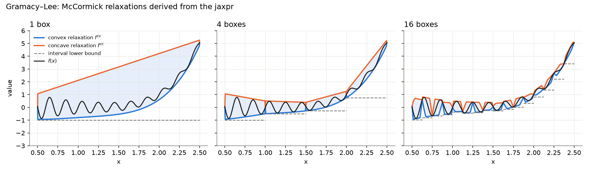
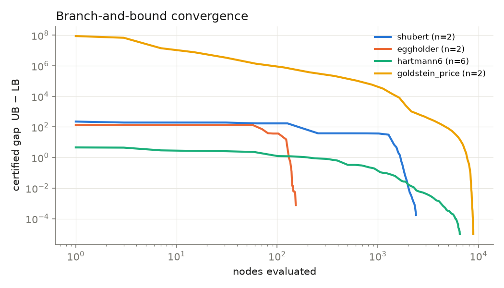

<p align="center"></p>

<p align="center"><a href="https://kitchingroup.cheme.cmu.edu/jax-go/"></a></p>

# jaxglobal — global optimization of plain JAX functions

Write an ordinary Python function with `jax.numpy`, give a box, and get a
**certified** global minimum: an upper bound (a feasible point) and a proven
lower bound. You write no equations and no algebraic model.

```python
import jax.numpy as jnp
from jaxglobal import minimize

def f(x):                       # Eggholder: very rugged, optimum on the boundary
    a, b = x[0], x[1]
    return -(b + 47) * jnp.sin(jnp.sqrt(jnp.abs(a / 2 + b + 47))) \
           - a * jnp.sin(jnp.sqrt(jnp.abs(a - (b + 47))))

r = minimize(f, [-512, -512], [512, 512])
# Result(status='optimal', fun=-959.64066, lower_bound=-959.64071, gap=4.78e-05,
#        x=[512. 404.231805], nodes=41, iterations=8, time=1.97s)
```

## Status

jaxglobal is past the proof-of-concept stage. It is a research solver: usable,
tested, and measured on MINLPLib, but not yet competitive with mature global
solvers on general problems (see [Limitations](#limitations)).

* **Problems:** continuous and mixed-integer, with inequality and equality
  constraints, on finite or partly unbounded boxes. Models can be plain JAX
  functions or AMPL `.nl` files (`jaxglobal.nl.read_nl`).
* **Correct answers so far:** 0 wrong answers on the MINLPLib sets below, all
  checked against the library's reference bounds. Every returned point is
  re-checked in float64, and an opt-in `safe=True` mode rounds the bounds
  outward.
* **MINLPLib, 60 s limit, cold start (compilation included):**

  | set | jaxglobal | SCIP |
  |---|---:|---:|
  | `start50`: 50 continuous instances, ≤ 50 variables, weighted toward hard ones | 31 | 44 |
  | `int50`: 50 mixed-integer instances, ≤ 50 variables | 29 | 45 |

  jaxglobal solves no `int50` instance that SCIP does not. Details:
  [`benchmarks/sets/README.md`](benchmarks/sets/README.md) and
  [`docs/ROADMAP.md`](docs/ROADMAP.md).
* **What it is for:** problems defined by code, which equation-based solvers
  cannot read at all or need rewritten by hand: `jnp.where` logic,
  neural-network and Gaussian-process surrogates, ODE kinetics written as
  Python loops.

Narrated, executed notebooks in [`examples/`](examples/README.md) walk through
the relaxations, branch and bound, the test problems, the comparison with
equation-based solvers, and batched throughput.

## How it works

1. **Trace.** `jax.make_jaxpr(f)` turns the Python function into a flat list of
   primitives (`sin`, `mul`, `integer_pow`, `dot_general`, `slice`, …).
   Python loops, helper functions, `jnp.where`, `jax.nn.*`, and `jit`/`custom_jvp`
   sub-calls all disappear into this list.
2. **Re-interpret the jaxpr on McCormick objects** `MC(lo, hi, cv, cc)` in
   `jaxglobal/relax.py`. Every primitive has a rule:
   * *structural / positive-linear* primitives (slice, reshape, add, reduce_sum,
     concatenate, gather, …) apply component-wise;
   * *signed linear* (neg, sub, mul or `dot_general` by a constant) swap by sign;
   * *bilinear* `mul` uses the McCormick product rule;
   * *univariate* primitives use McCormick composition with known envelopes
     (exp, log, sqrt, xⁿ, |x|, 1/x, pow, cosh, max/min) **or an automatically
     derived αBB relaxation**. For sin, cos, tanh, logistic, erf, atan, …, the
     interpreter traces `jax.grad(jax.grad(prim))`, evaluates *that* jaxpr in
     interval mode to bound f″, and builds `f(z) ± α/2 (z−lo)(z−hi)`.
     Adding a new smooth primitive needs only its range function.
   * comparisons / `select_n` (from `jnp.where`) are resolved when the interval
     decides the branch and fall back to the hull otherwise.
3. **The relaxation is itself a JAX function**, so it can be `jit`-ed,
   `vmap`-ed over hundreds of boxes, and differentiated. `jax.grad(cv)` gives
   subgradients of the convex relaxation. A few Frank–Wolfe steps on cv give
   affine cuts `cv(x) + g·(v − x)`, whose minimum over the box is a valid lower
   bound (`jaxglobal/bnb.py`).
4. **Batched spatial branch-and-bound.** Each iteration bisects the 128
   lowest-bound boxes and bounds all 256 children in one `jit(vmap(...))` call.
   L-BFGS-B (with `jax.grad`) polishes the incumbent.
5. **Bound tightening against the incumbent** (`f <= UB`), all batched:
   * *FBBT* (`jaxglobal/fbbt.py`): the jaxpr is flattened into a tape and swept
     forward (interval rules) and backward (inverse rules: `x ∈ Z − Y` for
     add, `x ∈ log Z` for exp, the two-sided root for `x²ⁿ` and `|x|`, …) to
     a fixed number of rounds before every node is bounded;
   * *duality-based range reduction*: the cut / LP-dual certificate
     `f ≥ lb + Σ r_j (x_j − lo_j)` confines each variable to where it could
     still beat the incumbent, at no extra cost;
   * *OBBT* (`lp.make_obbt`): min and max of every variable over the
     outer-approximation LP, as 2n `vmap`-ed LPs with weak-duality-certified
     results; on the root by default (`obbt="tree"` for every node).
   Children are split from the tightened box.
6. **Univariate envelopes** (`jaxglobal/univariate.py`, on by default). Every
   smooth sub-expression whose elements each depend on one variable (found
   structurally on the jaxpr: separable sums, polynomial factors,
   `sin(x)·sin(x²)^20`, ...) is sampled on a 65-point grid. The samples are
   lowered by `max(g″, 0)·h²/8`, with `g″` bounded per cell by interval
   evaluation of `jvp(jvp(g))`, and their lower convex hull is a nearly exact
   convex envelope (symmetrically for the concave one). It is intersected
   with the McCormick relaxation, so it never loosens it. On Styblinski–Tang
   the root bound goes from −612 to −118.6 (f* = −117.5).
   An extended-space LP bound (`jaxglobal/lifted.py`, `lifted=True`) is also
   available: one LP column per nonlinear jaxpr node, cut from that node's own
   McCormick rule at FBBT-tightened bounds.



## Results ([`examples/03-test-problems.ipynb`](examples/03-test-problems.ipynb))

Tolerance: gap ≤ max(1e-5, 1e-6·|f|). *Root LB* is plain interval arithmetic
on the whole box. *mstart* is the fraction of 20 random L-BFGS-B starts that
reach f\*, which shows how multimodal each problem is.

| problem | n | f\* (lit.) | found | proven LB | root LB | mstart | nodes | time |
|---|---|---|---|---|---|---|---|---|
| gramacy_lee | 1 | −0.869011 | −0.869011 | −0.869011 | −1 | 15% | 5 | 2.4s |
| six_hump_camel | 2 | −1.031628 | −1.031628 | −1.031632 | −156 | 95% | 21 | 2.3s |
| mccormick | 2 | −1.913223 | −1.913223 | −1.913224 | −13.5 | 55% | 11 | 1.1s |
| goldstein_price | 2 | 3.000000 | 3.000000 | 2.999998 | −8.79e7 | 60% | 1441 | 2.9s |
| shubert | 2 | −186.730909 | −186.730909 | −186.731070 | −225 | 0% | 277 | 2.3s |
| michalewicz_2d | 2 | −1.801303 | −1.801303 | −1.801303 | −2 | 5% | 11 | 2.2s |
| holder_table | 2 | −19.208503 | −19.208503 | −19.208518 | −33.2 | 0% | 279 | 2.4s |
| eggholder | 2 | −959.640663 | −959.640663 | −959.640711 | −1.07e3 | 0% | 41 | 1.5s |
| hartmann3 | 3 | −3.862782 | −3.862780 | −3.862789 | −8.4 | 50% | 91 | 1.6s |
| styblinski_tang_3d | 3 | −117.498497 | −117.498497 | −117.498551 | −638 | 15% | 9 | 1.5s |
| shekel10_4d | 4 | −10.536443† | −10.536443 | −10.536453 | −35.4 | 25% | 67 | 1.8s |
| hartmann6 | 6 | −3.322368 | −3.322368 | −3.322377 | −8.4 | 55% | 1035 | 1.6s |
| piecewise_2d (where/abs/max) | 2 | — | −0.823199 | −0.823202 | −3.7 | 25% | 29 | 1.8s |
| tanh_net_2d (16-unit MLP) | 2 | — | −0.553102 | −0.553105 | −2.8 | 30% | 239 | 1.3s |

† The usual −10.5364 is f(4,4,4,4); the true minimizer is slightly off that point.
Times are wall-clock on a laptop CPU for a first (cold) call, so they are
mostly JIT compilation; a second solve of the same function reuses the
compiled kernels and takes a small fraction of that (see notebook 04). For the two
problems without a published optimum, the tests check the certificate against
a 401×401 brute-force grid.



Excluded on purpose: sum-of-squares problems with f\* = 0 (Rosenbrock,
Himmelblau, Rastrigin, Ackley, Levy) and Branin. Plain interval arithmetic
already proves their optimum at the root node, so they show nothing about the
relaxations.

## Constraints

`minimize(f, lo, hi, ineq=g, eq=h)` handles `g(x) <= 0` and `h(x) == 0`, where
`g` and `h` are plain JAX functions returning a scalar or a 1-D array.

* **Lower bound** (`jaxglobal/lp.py`): the relaxations give convex functions
  `cv_f`, `cv_g`, `cv_h`, `-cc_h`. `jax.jacfwd` turns them into affine cuts at
  the box center, 2n axis points, and 4 Kelley points. The small LP is solved by
  a fixed-iteration primal–dual interior point method in JAX, so it `vmap`s over
  boxes. The bound **does not trust the LP solver**. Weak duality gives a valid
  bound for *any* multipliers y ≥ 0, and the best value over all IPM iterates is
  kept. A badly converged LP gives a weaker bound, never a wrong one.
  Interval arithmetic prunes boxes that are provably infeasible.
  Problems whose functions are all quadratic are bounded instead over a lifted
  sparse LP with one column per product, McCormick facets and RLT rows
  (`jaxglobal/quadratic.py`, `quadratic=True` by default).
* **Upper bound**: a local NLP solve with JAX gradients and Jacobians, started
  from the LP solutions: pounce (default when installed), optax or scipy
  SLSQP (`local_solver=`). A point counts as feasible when the violation is
  ≤ `feas_tol`.
* **Branching** only on variables that appear nonlinearly, detected from
  sampled Hessians.
* `status` is `"optimal"`, `"infeasible"`, `"max_iter"`, `"time_limit"`,
  `"unbounded_domain"` or `"unverified"` (see *Correctness checks*).

| problem | n | f\* | found | proven LB | nodes | time |
|---|---|---|---|---|---|---|
| G06 | 2 | −6961.813876 | −6961.813876 | −6961.817313 | 11 | 2.7s |
| G08 | 2 | −0.095825 | −0.095825 | −0.095828 | 19 | 4.8s |
| G11 (equality) | 2 | 0.750000 | 0.750000 | 0.749999 | 7 | 0.8s |
| G24 (disconnected feasible set) | 2 | −5.508013 | −5.508013 | −5.508016 | 43 | 1.5s |
| G04 | 5 | −30665.538672 | −30665.538672 | −30665.561787 | 13 | 5.0s |
| Haverly pooling | 9 | −400.000000 | −400.000019 | −400.000115 | 17 | 4.9s |
| Reactor network | 6 | −0.388811 | −0.388811 | −0.388821 | 159 | 5.0s |

Equality optima can sit slightly below f\* because of `feas_tol` (1e-6).

## Integer variables

`minimize(f, lo, hi, ineq=g, integer=[0, 3])` (indices or a boolean mask)
makes those variables integer. Their bounds are rounded inward, FBBT rounds
their ranges, branching splits them at integer values, and integer dives and
root probing look for incumbents. The returned `x` is integral, and
`Result.verified` checks that. The node bounds are the relaxations of the
continuous problem, with no MILP cutting planes. `.nl` files with integer
variables are read with their integer mask.

### Choosing `branch_var`

The default, `branch_var="auto"`, branches on pseudocosts (the bound gains
measured on earlier splits of each variable) when there are no integer
variables, and on `width` (relative width times the relaxation gap, fractional
integers first) when there are. Those were the best measured choices: on the
MINLPLib start50 set pseudocost solves 38 instances in 60 s against 36 for
width and for `strong`, and on the 25 built-in and synthetic problems it takes
the least total time. On
int50 pseudocost and `strong` each solve one more instance than width, but each
loses one that width solves (flay04m and nous1). Override it when:

* a continuous problem takes more nodes with pseudocost than with width
  (holder_table 279 vs 191, tanh_net_2d 241 vs 189): try `width`;
* bounding a box is cheap and the tree is small to medium: `strong` bounds
  trial children for the candidates and often needs far fewer nodes (hartmann6
  634 vs 1081, univariate_sum_20 205 vs 665), but on deep trees it can cost
  more than it saves (nn_tanh_5x8x2: 575k nodes vs 244k);
* an integer problem stalls with a large gap: try `pseudocost` or `strong`
  (tln4 and tspn05 are solved by both and not by width).

## Gaussian-process surrogates

A GP prediction written in `jax.numpy` is already a reduced-space model
([Schweidtmann et al. 2021](#ref-schweidtmann2021deterministic)). Write its kernel with `jaxglobal.kernels`
(`matern12`, `matern32`, `matern52`, `se`, each a function of the weighted
squared distance `d`) instead of the `jnp` formula:

```python
from jaxglobal import kernels

def gp_mean(x):
    d = jnp.sum(((x - X_train) / lengthscales) ** 2, axis=-1)
    return y_mean + alpha @ kernels.matern52(d)
```

Each kernel is a JAX primitive that is one convex, nonincreasing function of
`d`, so it is relaxed by its envelopes; written in `jnp`, the Matérn kernels
are relaxed factor by factor. Its derivatives are primitives too, so αBB gets
a finite Hessian at the training points (Matérn 5/2 and SE). On the GP mean of
the peaks function (Matérn 5/2, abs/rel gap 1e-3), same answers:

| training points | nodes, `jnp` formula | nodes, `kernels.matern52` | time |
|---:|---:|---:|---|
| 20 | 1079 | 89 | 28 s → 19 s |
| 50 | 3489 | 425 | 22 s → 11 s |
| 100 | 6165 | 665 | 44 s → 17 s |
| 200 | 23191 | 2343 | 67 s → 8.7 s |

(cold solves, compilation included.) Matérn 3/2 at N = 50: 1917 → 429 nodes.
SE and Matérn 1/2 are unchanged: their `jnp` formulas were already relaxed
exactly.

The posterior standard deviation needs more: it is a quadratic form in the
kernel vector, and bounds through `K⁻¹` inherit its conditioning.
`jaxglobal.gp.gp_std(x, Z, lengthscale, Kinv, sf2, kernel=...)` has the same
value, and its relaxation uses the GP's structure: the quadratic form as a sum
of squares, and the bound `|σ(x) − σ(c)| ≤ sd_prior(f(x) − f(c))`, which holds
because the posterior is itself a Gaussian process and does not involve
`K⁻¹`. On a 95% chance constraint (`mean + 1.96 std ≤ c`) the solve is now
certified in 2807 nodes and 11 s, where the formula did not close in 120 s
(140k nodes). `gp_mean` is the matching mean.

The acquisition functions are primitives too:
`expected_improvement(mu, sigma, fmin)` is relaxed as the jointly convex,
monotone function it is (the perspective of `zΦ(z) + φ(z)`), with the concave
envelope over the `(mu, sigma)` box, and
`probability_of_improvement(mu, sigma, target)` from its monotonicity plus the
exact envelopes of `Φ`, instead of `Φ`, `φ` and the division one by one. On
the 20-point GP of example 06, with `gp_std`: EI 1401 → 765 nodes (warm solve
0.9 s → 0.4 s), PI 727 → 451 (0.55 s → 0.4 s; PI's first, compiling solve is
slower). [`examples/06-gaussian-processes.ipynb`](examples/06-gaussian-processes.ipynb)
repeats the paper's case studies: GP means, acquisition functions, a chance
constraint and a Bayesian-optimization loop.

## Comparison with equation-based solvers

`examples/compare.py` builds Pyomo models from **the same Python functions**,
using a `jnp`→Pyomo shim on numpy object arrays. It then runs SCIP and Couenne
(via `.nl` files) and BARON and LindoGlobal (via GAMS). `where`/`maximum` and
`tanh` had to be reformulated by hand; [`jaxglobal.export`](#export-to-scip-and-nl)
now does that automatically. BARON rejects every model containing
`sin`/`cos` ("Cannot handle function 'sin'"). Results go to
`examples/compare_results.json`. The notebook
[`examples/04-equation-based-solvers.ipynb`](examples/04-equation-based-solvers.ipynb)
walks through the shim and the reformulations, re-measures jaxglobal (cold,
including compilation, and compiled), and draws `figures/benchmark.png`. The
slides in `slides/jaxglobal.md` summarize this.

**Pyomo side by side.** The notebooks in [`notebooks/`](notebooks/README.md)
write each model twice, in Pyomo and as a plain JAX function, and solve both:
basic and pooling problems, `where`/`clip`/table lookups, RK4 kinetics, NN
surrogates, and things Pyomo cannot express directly.

**Flagship benchmark.** `jaxglobal.applications` holds code-defined models
(ODE kinetics, regime-switching engineering models, tanh NN surrogates after
[Schweidtmann & Mitsos 2018](#ref-schweidtmann2019deterministic)), each with a hand-written Pyomo twin.
`benchmarks/flagship.py` runs jaxglobal, SCIP, Couenne and BARON on them and
judges each answer against the best known optimum.

## Export to SCIP and `.nl`

`jaxglobal.export` takes a problem in the same form `minimize` takes it (`f`,
`lo`, `hi`, `ineq`, `eq`, `integer`) and builds a PySCIPOpt model or writes an
AMPL `.nl` file for Couenne, SCIP, BARON or `jaxglobal.nl.read_nl`. You do not
write a Pyomo twin or reformulate anything by hand. The functions are traced,
`scan`/`fori_loop` and fixed-count `while_loop`s are unrolled, and `jit` and
`custom_jvp` calls are inlined. Every operation is then translated exactly,
replaced by an exact identity, reformulated with auxiliary variables, or
refused with an `ExportError` that names it. The report's `approximated` field
lists the few things that are not exact (see below). Evaluate `f` with JAX at
the solver's `x` before you trust its objective value.
[`examples/export_scip.py`](examples/export_scip.py) exports a model that uses
`where`, `maximum`, `tanh`, `relu`, a `fori_loop` and an integer variable, solves
it with SCIP, and compares the result with `minimize`.

```python
from jaxglobal import export

m = export.to_scip(f, lo, hi, ineq=g, eq=h, integer=[2])   # a pyscipopt.Model
print(m.data.report)                  # what happened to each operation
m.setParam("limits/time", 60); m.optimize()
x = export.solution(m)                # best point, in the order of x

r = export.to_nl(f, lo, hi, "model.nl", ineq=g)   # returns the report
# r.var_order[k] is the variable of .nl column k (integers are written last)
export.to_nl(f, lo, hi, "portable.nl", ineq=g, portable=True)  # readable by the scip and couenne binaries
export.inspect(f, lo, hi, target="scip")          # report only; does not raise
```

| | SCIP (`to_scip`) | `.nl` (`to_nl`) |
|---|---|---|
| exact | `+ - * /`, neg, sum, dot/matmul, reductions, `x**p` (constant `p`), exp, log, sqrt, abs, sin, cos; indexing, slicing, reshape, broadcast, concatenate, stack | the SCIP set, plus tan, tanh, sinh, cosh, atan, asin, acos, atanh, asinh, acosh, atan2, `x**y`; by default also max, min, `where` (`if`) and comparisons |
| exact rewrite | tanh → `1 - 2/(exp(2x)+1)` (or an overflow-free form, below), sigmoid, softplus, log1p, expm1, tan, sinh, cosh, asinh (odd form), acosh, atanh; `x**y` → `exp(y log x)` when `x > 0` on the box; max/min (and so relu, clip) → `(a + b ± \|a - b\|)/2` | sigmoid, log1p, expm1; sign as nested `if` |
| reformulated | `where`/`select_n` (aux `y` and four big-M rows); `<`, `<=`, `>`, `>=` (a binary); `sign` (two binaries); and/or/not; max/min with `minmax="bigm"`; shared subexpressions of 50+ operations (aux `w == expr`); product operands that pyscipopt would expand past 1000 monomials | the same as SCIP, with `nonsmooth="reformulate"` or `portable=True` |
| not exact (`approximated`) | reformulated comparisons and `sign` at ties (below); `reduce_precision` and float64→float32 casts (identities) | the same, when reformulated |
| refused | erf and other special functions, a `while_loop` whose condition depends on `x`, `lax.cond` on a model value, float→int conversion and indices computed from `x`, `==`/`!=` between model values, atan/asin/acos/atan2, a `where` branch undefined on part of the box (below), big-M constants ≥ 1e20, an intermediate value that reaches 1e20 over the box, division by the constant 0, any primitive not listed | the same, minus the inverse trig functions (refused again with `portable=True`) |

Big-M constants come from interval bounds of the operands over the box. A
reformulation is refused when a bound is not finite or a constant reaches 1e20
(SCIP's infinity). Above 1e8 the export warns (`ExportBigMWarning`) and adds a
note, because the solver's tolerances, multiplied by M, then decide which branch
is taken.

Points to check:

- **Ties.** A reformulated comparison cannot be strict. With `strict_eps=0`
  (the default), at a tie `u == v` either branch is allowed. Where the two
  branches of a `where` agree at the tie (relu, a continuous switch) that is
  harmless. For a piecewise-constant model, such as a step or `sign`, the model
  is a relaxation: the solver can return a breakpoint value that JAX never
  produces. `strict_eps > 0` excludes `0 < |u - v| < strict_eps` on the wrong
  side, which is a restriction instead. Pick it well above the solver's
  feasibility tolerance (SCIP: 1e-6). Either way, evaluate `f` with JAX at the
  returned `x`.
- **Branch domains.** The reformulation of `where` evaluates both branches
  everywhere, so `jnp.where(x > 0, jnp.sqrt(x), x)` would lose `x < 0`. The
  export refuses it and names the operation. Make the branch defined
  everywhere: `jnp.sqrt(jnp.maximum(x, 0))`. The double-`where` idiom
  `jnp.where(x > 0, jnp.sqrt(jnp.where(x > 0, x, 1.0)), x)` is also refused:
  the check uses interval bounds, which cannot see that the inner `where`
  keeps `sqrt`'s argument positive. Use the `maximum` form.
- **Overflow.** SCIP treats a value of 1e20 or more as infinity, and a point
  where any intermediate expression reaches it as an invalid evaluation, which
  it cuts off. The `tanh` and `sigmoid` rewrites therefore pick a form from the
  argument's interval in which no `exp` overflows (`exp(-2x)` when `x >= 0`;
  `exp(x)/(1 + exp(x))` when `x <= 0`; `exp(x - |x|)` and `exp(-x - |x|)`, both
  at most 1, when the interval straddles 0 with large `|x|`), and `asinh` /
  `acosh` avoid `x^2` for `|x| > 1e9`. All of these are exact. Any other
  intermediate whose interval bound reaches 1e20 while its operands are bounded
  (such as `exp(x)` for `x` up to 60) is refused; tighten the bounds.
- **Which `.nl` reader.** The default `.nl` keeps max, min, `if` and the
  inverse and hyperbolic functions as operators. `read_nl` reads them all, but
  the `scip` binary's reader takes only `+ - * /`, neg, pow, exp, log, sqrt,
  abs, sin, cos and sums. Couenne also takes tan, tanh, sinh and cosh. Neither
  takes min/max, `if`/comparisons, atan/asin/acos/atan2 or the inverse
  hyperbolic functions. `portable=True` writes only what both read. It
  rewrites and reformulates the rest as for SCIP, and it uses auxiliary
  variables instead of defined variables (`V` segments). Use `portable=True`
  with Couenne: Couenne 0.5.8 misreads `V` segments in general, even in
  files AMPL itself writes (six-hump camel gives -0.3232 instead of -1.0316).

**Reading the report**
(`model.data.report`, the return value of `to_nl`, or `inspect`):

- the first line counts the original and auxiliary variables (binaries among
  them), the original and added constraints, and the scalar operations;
- `exact`, `rewritten` and `reformulated` give per-operation counts, and the last
  two name the identity or construction used;
- `approximated` lists what is not exact and how (ties, precision casts). If it
  is not empty, evaluate `f` at the solver's `x`;
- `objective: epigraph` means the nonlinear objective became `f(x) <= t`;
- `refused` lists what blocked the export (`inspect` returns this instead of
  raising);
- `assumption` lists the simplifications that hold at finite points: `isnan` of
  a model value is False and `isfinite` is True;
- `note` lists unrolled iterations, dropped constant constraints, and the
  largest big-M constant when it is above 1e8.

`ExportSizeWarning` fires above `max_size` scalar operations (default 1e5).

## Correctness checks

`minimize(..., safe=True)` widens every relaxation outward by a few ulps so
floating-point rounding cannot cut off the global minimum (off by default, about
1.7× slower). Every result is re-evaluated in float64; a point that violates the
constraints is reported with status `"unverified"` and its `max_violation`.
`tests/test_fuzz.py` checks bounds against sampled points on random problems
(`JAXGLOBAL_FUZZ=N` for more cases), and `benchmarks/check_wrong.py` exits
nonzero on any wrong or unverified MINLPLib answer.

## Run

```bash
pip install -e '.[dev]'
pytest -q                      # soundness, cut validity, global optima, integers
cd examples && ./run_nb.sh 03-test-problems && cd ..   # see examples/README.md

# MINLPLib benchmark (phase 0 of docs/ROADMAP.md)
python benchmarks/minlplib/fetch.py          # 322 continuous instances, ≤ 50 variables
python benchmarks/run.py --time-limit 60     # jaxglobal, SCIP, Couenne, BARON (GAMS)
python benchmarks/report.py                  # checked results, SGM time, profiles
```

Any AMPL `.nl` model (text or binary) can be loaded with
`jaxglobal.nl.read_nl(path)`, which returns `f`, `ineq`, `eq`, `lo`, `hi` for
`minimize`.

## Lessons / gotchas found so far

* **Autodiff subgradients need tie-aware rules.** At points where cv == cc (box
  vertices, which is exactly where Frank–Wolfe iterates go), `jnp.minimum`
  splits the gradient 50/50 between its arguments. In the product rule and in
  the composition `mid(·)` this blends the *concave* relaxation's gradient into
  a "subgradient" of the convex one. The result is invalid cuts and a wrong
  certificate (Eggholder reported −935 as optimal). The fix is to select
  branches with `jnp.where` on sign or ordering. `test_cuts_valid` guards this
  and fails on 9 problems if the fix is reverted.
* **A cut must use one evaluation of its value and slope.** Under `jit`, XLA
  may recompute a value separately for each of its uses, and at a near-tie
  between two McCormick facets the copies can pick different facets. A cut that
  takes its coefficients from one facet and its offset from the other is
  invalid; on jax 0.11 this made the lifted LP infeasible and its bound ~1e277.
  Values and slopes of every cut go through `jax.lax.optimization_barrier`.
* **αBB amplifies rounding.** `f + a/2 (z − lo)(z − hi)` has a slope of about
  `a (hi − lo) / 2` that `f` does not, so on a wide range (a quotient with a
  tiny denominator) a one-ulp error in `z`'s relaxation became 4e-8 in the
  bound. `alphabb_rule` widens its input by a few ulps first.

## Limitations

* **Scale.** On 328 mixed-integer MINLPLib instances with up to 100
  variables (60 s, cold), jaxglobal solved 72 of the 220 with at most 50
  variables and 1 of the 108 with 51 to 100. At that size the time goes to
  setup (tracing, compiling, the first dense LP) before the search starts. The
  node LP is a dense interior point method whose cost grows as rows × n² per
  iteration. Only quadratic problems get a sparse lifted LP.
* **Speed.** Shifted geometric mean time at 60 s, cold: 32.6 s against
  SCIP's 1.9 s on `start50`, and 35.9 s against 1.35 s on `int50`. Much of
  jaxglobal's cold time goes to tracing and compiling the bounding kernels. The kernels are cached in memory and on disk
  under `~/.cache/jaxglobal` (`$JAXGLOBAL_CACHE_DIR`; `JAXGLOBAL_CACHE=0`
  turns the cache off), so a repeat solve of the same model takes about
  0.3-1 s on the built-in problems instead of 2-7 s. The cache prunes its own
  entries, oldest first, past about 2 GB of XLA executables and 512 kernels
  (kernels of other jaxglobal versions after a day unused). Clear it
  with `python -c "import jaxglobal.kcache as k; k.clear_cache()"`.
* **Relaxations.** The relaxations are reduced-space McCormick and αBB,
  univariate envelopes, scaled-Gershgorin αBB and interval arithmetic. They
  are weak on big-M, cardinality and some bilinear structure. There are no
  MILP cuts, no trilinear envelopes and no probing on continuous variables.
  FBBT's tightened intermediate ranges are not yet fed back into the
  relaxations. The general lifted LP (`lifted=True`) is opt-in and slower.
* **Floating point.** The default mode is not rigorous. `safe=True` rounds
  lower bounds outward by a few ulps per operation, but it assumes XLA
  transcendentals are accurate to a few ulps and does not cover every margin
  (see *Phase 6* in [`docs/ROADMAP.md`](docs/ROADMAP.md)). Feasibility holds
  to `feas_tol`, not exactly.
* **Supported JAX.** `dot_general` between two variable-dependent arrays is
  supported only for 1-D inner products. `lax.cond`, `while_loop` and `scan`
  with variable-dependent control flow are not supported; Python control flow
  on static values is fine. An unsupported primitive raises
  `NotImplementedError` naming the primitive.
* **Unbounded variables.** Finite bounds are derived first
  (`jaxglobal/domain.py`): FBBT from the declared box, unused variables fixed,
  then FBBT against `f <= UB` once a local solve finds a feasible point. A
  variable that nothing bounds gives status `"unbounded_domain"` rather than a
  guessed box. FBBT cannot prove bounds that need joint reasoning over several
  constraints.
* **Hardware.** Development and benchmarks are on CPU. The bounding step is a
  pure `jit(vmap)` kernel, but the branch-and-bound loop runs on the host, and
  GPU throughput has not been measured.

## Next steps

The plan, with measurements for each phase, is in
[`docs/ROADMAP.md`](docs/ROADMAP.md). Next on it:

* a sparse or first-order LP for the node bound beyond quadratic problems;
* lower setup and compile cost for models with 50 to 100 variables;
* tighter relaxations: FBBT ranges fed into McCormick, and more structure
  detected from the jaxpr;
* a device-resident B&B loop for GPU;
* a fully rigorous mode with verified transcendental enclosures and an exact
  LP-dual check.

## Related work

Citation keys refer to [`docs/references.bib`](docs/references.bib). Every
entry with a DOI was checked against Crossref and its BibTeX taken from
Crossref by `docs/verify_refs.py` (116 entries). The 39 entries without a
Crossref DOI (conference papers, arXiv, software, reports) are written by
hand in `docs/refs.json`; the same script confirms each one from an
independent source: the arXiv record, the DOI record, OpenAlex, the GitHub
repository, or the entry's title on the publisher's page. The CEC 2006
report has no online record and was checked against its title page.
`tests/test_citations.py` fails on any `[key]` in the repo's `.py`, `.md` or
notebook sources that is not in the bibliography.

**McCormick relaxations of code.** The relaxation arithmetic is McCormick's
([McCormick 1976](#ref-mccormick1976computability)), in the generalized and subgradient form of
([Mitsos et al. 2009](#ref-mitsos2009mccormick); [Scott et al. 2011](#ref-scott2011generalized)). That work relaxes whole programs
by operator overloading (MC++ [chachuatmcpp, chachuat2015settheoretic]); MAiNGO
([Bongartz et al. 2018](#ref-bongartz2018maingo); [Bongartz & Mitsos 2017](#ref-bongartz2017deterministic)) and EAGO.jl
([Wilhelm & Stuber 2020](#ref-wilhelm2022eagojl)) are the solvers built on it. Reduced-space branching on
the original variables follows ([Epperly & Pistikopoulos 1997](#ref-epperly1997reduced)). Convergence theory:
([Bompadre & Mitsos 2011](#ref-bompadre2012convergence); [Najman & Mitsos 2016](#ref-najman2016convergence)). Possible tightenings:
multivariate rules ([Tsoukalas & Mitsos 2014](#ref-tsoukalas2014multivariate)), subgradient bound tightening
([Najman & Mitsos 2019](#ref-najman2019tighter)), reverse propagation ([Wechsung et al. 2015](#ref-wechsung2015reverse)), LP from
linearizations ([Najman et al. 2021](#ref-najman2021linearization)), Taylor and McCormick–Taylor models
([Makino & Berz 2003](#ref-makino2003taylor); [Sahlodin & Chachuat 2011](#ref-sahlodin2011convex); [Bompadre et al. 2012](#ref-bompadre2013convergence)), DAG interval propagation ([Schichl & Neumaier 2005](#ref-schichl2005interval)),
differentiable relaxations ([Khan et al. 2016](#ref-khan2017differentiable)), and relaxations of implicit
functions ([Stuber et al. 2014](#ref-stuber2015convex)), a route to relaxing `lax.while_loop`.
Embedded ML models: ([Schweidtmann & Mitsos 2018](#ref-schweidtmann2019deterministic); [Schweidtmann et al. 2021](#ref-schweidtmann2021deterministic); [Wilhelm et al. 2022](#ref-wilhelm2023convex)). jaxglobal's difference: no
operator overloading or code generation. The relaxation is a *re-interpretation
of the jaxpr*, so `jit`, `vmap` and `grad` apply to the bounding itself.

**αBB and interval Hessians.** αBB ([Androulakis et al. 1995](#ref-androulakis1995alphabb); [Adjiman & Floudas 1996](#ref-adjiman1996rigorous); [Adjiman et al. 1998](#ref-adjiman1998global); [Adjiman et al. 1998](#ref-adjiman1998globalii)) with tighter α
([Hladík 2014](#ref-hladik2015efficient); [Nerantzis & Adjiman 2019](#ref-nerantzis2019tighter); [Kazazakis & Adjiman 2018](#ref-kazazakis2018arbitrarily); [Skjäl et al. 2012](#ref-skjal2012generalization)) and univariate underestimators
([Gounaris & Floudas 2008](#ref-gounaris2008tight); [Meyer & Floudas 2005](#ref-meyer2005convex)). The closest prior art to evaluating
`grad(grad(primitive))` on intervals is AD-based interval Hessian bounding
([Mönnigmann 2008](#ref-monnigmann2008efficient); [Schulze Darup et al. 2013](#ref-schulzedarup2014efficient); [Schulze Darup & Mönnigmann 2016](#ref-schulzedarup2016improved); [Hladík 2017](#ref-hladik2017effect)). We found no prior work that applies αBB *automatically per
primitive* to every nonconvex primitive of a traced program.

**GPU and parallel global optimization.** The most direct competitors:
Gottlieb, Xu & Stuber generate McCormick kernels from Julia/Symbolics for
GPU-batched lower bounding ([Gottlieb et al. 2024](#ref-gottlieb2024automatic); [Gottlieb & Stuber 2026](#ref-gottlieb2026automatic));
Zhang et al. add GPU interval bounding to MAiNGO ([Zhang et al. 2025](#ref-zhang2025accelerating)).
Earlier GPU/parallel B&B: ([Barkalov & Gergel 2016](#ref-barkalov2016parallel); [Bagóczki & Bánhelyi 2017](#ref-bagoczki2017parallel); [Gillner & Auer 2024](#ref-gillner2024gpuaccelerated); [Gendron & Crainic 1994](#ref-gendron1994parallel); [Crainic et al. 2006](#ref-crainic2006parallel); [Gmys et al. 2016](#ref-gmys2016gpubased)). Spatial B&B and its convergence theory: ([Falk & Soland 1969](#ref-falk1969algorithm); [Horst & Tuy 1990](#ref-horst1990global); [Smith & Pantelides 1999](#ref-smith1999symbolic); [Kannan & Barton 2017](#ref-kannan2018convergenceorder)). Rigorous
and interval global optimization: ([Neumaier 2004](#ref-neumaier2004complete); [Kearfott 1996](#ref-kearfott1996rigorous); [Global Optimization Using Interval Analysis 2003](#ref-hansen2004global)). Branching rules: ([Achterberg et al. 2005](#ref-achterberg2005branching)).

**Bound propagation in ML and jaxpr interpreters.** jaxpr-interpreting
bounders already exist, but for other jobs:
- jax_verify ([Stanforth et al. 2020](#ref-stanforth2020jaxverify)): NN verification, with bilinear McCormick
  and B&B over activation/input splits.
- AutoBound ([Streeter & Dillon 2022](#ref-streeter2022automatically); [Streeter & Dillon 2023](#ref-streeter2023sharp)): Taylor enclosures,
  with a toy B&B.
- immrax ([Harapanahalli et al. 2024](#ref-harapanahalli2024immrax)): interval reachability.

The verification literature has GPU-batched bounding in B&B:
- linear bounds: IBP ([Gowal et al. 2018](#ref-gowal2018effectiveness)), CROWN ([Zhang et al. 2018](#ref-zhang2018efficient)),
  DeepPoly ([Singh et al. 2019](#ref-singh2019abstract)), auto_LiRPA ([Xu et al. 2020](#ref-xu2020automatic));
- B&B: α/β-CROWN ([Xu et al. 2021](#ref-xu2021fast); [Wang et al. 2021](#ref-wang2021beta)), GenBaB ([Shi et al. 2025](#ref-shi2025neural)),
  ([Bunel et al. 2020](#ref-bunel2020branch));
- dual and SDP relaxations: ([Dvijotham et al. 2018](#ref-dvijotham2018dual); [Dvijotham et al. 2020](#ref-dvijotham2020efficient); [Bunel et al. 2020](#ref-bunel2020lagrangian));
- relaxation-gap results: ([Salman et al. 2019](#ref-salman2019convex); [Tjandraatmadja et al. 2020](#ref-tjandraatmadja2020convex)).

AD at kinks can return values that are not subgradients
([Kakade & Lee 2018](#ref-kakade2018provably); [Lee et al. 2020](#ref-lee2020correctness); [Bolte & Pauwels 2020](#ref-bolte2020mathematical); [Bolte & Pauwels 2020](#ref-bolte2021conservative)). This is the failure mode behind jaxglobal's tie-aware
rules (see *Lessons* above). Nonsmooth implicit differentiation:
([Bolte et al. 2024](#ref-bolte2024differentiating)). Principled fixes: abs-normal forms
([Griewank 2013](#ref-griewank2013stable); [Griewank et al. 2015](#ref-griewank2015solving)) and lexicographic derivatives
([Nesterov 2005](#ref-nesterov2005lexicographic); [Khan & Barton 2013](#ref-khan2013evaluating); [Khan & Barton 2015](#ref-khan2015vector)).

**LP bounds.** Node bounds come from cuts ([Kelley 1960](#ref-kelley1960cuttingplane); [Frank & Wolfe 1956](#ref-frank1956algorithm); [Jaggi 2013](#ref-jaggi2013revisiting)), fed to an interior-point LP
([Mehrotra 1992](#ref-mehrotra1992implementation); [Wright 1997](#ref-wright1997primaldual)). The bound is made safe by
weak duality with box bounds, following ([Neumaier & Shcherbina 2004](#ref-neumaier2004safe); [Jansson 2004](#ref-jansson2004rigorous); [Keil & Jansson 2006](#ref-keil2006computational)). That safety is what allows first-order GPU LP solvers
in the tree: PDLP ([Applegate et al. 2021](#ref-applegate2021practical); [Applegate et al. 2026](#ref-applegate2026pdlp); [Applegate et al. 2022](#ref-applegate2023faster); [Applegate et al. 2024](#ref-applegate2024infeasibility)), cuPDLP
([Lu & Yang 2025](#ref-lu2025cupdlpjl); [Lu & Yang 2025](#ref-lu2025practical)), and MPAX in JAX ([Lu et al. 2024](#ref-lu2024mpax)). Batched
differentiable solvers: ([Amos & Kolter 2017](#ref-amos2017optnet); [Agrawal et al. 2019](#ref-agrawal2019differentiable)).

**Global solvers and bound tightening** (comparison baselines and roadmap
targets):
- solvers: BARON ([Tawarmalani & Sahinidis 2005](#ref-tawarmalani2005polyhedral); [Khajavirad & Sahinidis 2018](#ref-khajavirad2018hybrid)), SCIP
  ([Vigerske & Gleixner 2017](#ref-vigerske2018scip); [Bestuzheva et al. 2023](#ref-bestuzheva2025global); [Bolusani et al. 2024](#ref-bolusani2024scip); [Hojny et al. 2025](#ref-hojny2025scip)),
  Couenne ([Belotti et al. 2009](#ref-belotti2009branching)), ANTIGONE ([Misener & Floudas 2014](#ref-misener2014antigone)),
  LindoGlobal ([Lin & Schrage 2009](#ref-lin2009global));
- bound tightening: FBBT ([Belotti et al. 2010](#ref-belotti2010feasibilitybased)), domain reduction
  ([Puranik & Sahinidis 2017](#ref-puranik2017domain); [Ryoo & Sahinidis 1996](#ref-ryoo1996branchandreduce));
- checking solver claims against reference values: ([Neumaier et al. 2005](#ref-neumaier2005comparison)),
  which `benchmarks/report.py` follows.

**Local solvers and infrastructure.**
- local solvers: pounce derives from Ipopt ([Wächter & Biegler 2005](#ref-wachter2006implementation));
  L-BFGS(-B) ([Liu & Nocedal 1989](#ref-liu1989limited); [Byrd et al. 1995](#ref-byrd1995limited)), SLSQP ([Kraft 1988](#ref-kraft1988software));
- augmented Lagrangian: ([Hestenes 1969](#ref-hestenes1969multiplier); [Powell 1969](#ref-powell1969method));
- tools: SciPy ([Virtanen et al. 2020](#ref-virtanen2020scipy)), JAX ([Bradbury et al. 2018](#ref-bradbury2018jax); [Frostig et al. 2018](#ref-frostig2018compiling)),
  optax ([DeepMind et al. 2020](#ref-deepmind2020deepmind)), AD ([Griewank & Walther 2008](#ref-griewank2008evaluating));
- modeling for the comparisons: Pyomo ([Hart et al. 2011](#ref-hart2011pyomo); [Bynum et al. 2021](#ref-bynum2021pyomo)), GAMS
  ([Brook et al. 1988](#ref-brooke1988gams));
- related MINLP work by the author: discopt ([Kitchin 2026](#ref-kitchin2026discopt)), which uses
  an algebraic modeling API rather than tracing;
- ML-embedded optimization: ([Ceccon et al. 2022](#ref-ceccon2022omlt); [Tsay et al. 2021](#ref-tsay2021partition); [Kronqvist et al. 2025](#ref-kronqvist2025psplit); [Anderson et al. 2020](#ref-anderson2020strong); [Fischetti & Jo 2018](#ref-fischetti2018deep); [Grimstad & Andersson 2019](#ref-grimstad2019relu)).

**Test problems.**
- sources: ([Floudas et al. 1999](#ref-floudas1999handbook); [Ryoo & Sahinidis 1995](#ref-ryoo1995global); [Haverly 1978](#ref-haverly1978studies); [Michalewicz & Schoenauer 1996](#ref-michalewicz1996evolutionary); [Liang et al. 2006](#ref-liang2006problem); [Surjanovic & Bingham 2013](#ref-surjanovic2013virtual); [Jamil & Yang 2013](#ref-jamil2013literature));
- MINLPLib ([Bussieck et al. 2003](#ref-bussieck2003minlplib)).

## References

Generated from `docs/references.bib` by `docs/readme_bib.py`.

<a id="ref-achterberg2005branching"></a>Achterberg, T., Koch, T., Martin, A. (2005). Branching rules revisited. *Operations Research Letters* 33(1), 42–54. [doi:10.1016/j.orl.2004.04.002](https://doi.org/10.1016/j.orl.2004.04.002)

<a id="ref-adjiman1996rigorous"></a>Adjiman, C. S., Floudas, C. A. (1996). Rigorous convex underestimators for general twice-differentiable problems. *Journal of Global Optimization* 9(1), 23–40. [doi:10.1007/bf00121749](https://doi.org/10.1007/bf00121749)

<a id="ref-adjiman1998global"></a>Adjiman, C., Dallwig, S., Floudas, C., Neumaier, A. (1998). A global optimization method, αBB, for general twice-differentiable constrained NLPs — I. Theoretical advances. *Computers & Chemical Engineering* 22(9), 1137–1158. [doi:10.1016/s0098-1354(98)00027-1](https://doi.org/10.1016/s0098-1354(98)00027-1)

<a id="ref-adjiman1998globalii"></a>Adjiman, C., Androulakis, I., Floudas, C. (1998). A global optimization method, αBB, for general twice-differentiable constrained NLPs—II. Implementation and computational results. *Computers & Chemical Engineering* 22(9), 1159–1179. [doi:10.1016/s0098-1354(98)00218-x](https://doi.org/10.1016/s0098-1354(98)00218-x)

<a id="ref-agrawal2019differentiable"></a>Agrawal, A., Amos, B., Barratt, S., Boyd, S., Diamond, S., Kolter, J. Z. (2019). Differentiable Convex Optimization Layers. *Advances in Neural Information Processing Systems* 32. <https://proceedings.neurips.cc/paper/2019/hash/9ce3c52fc54362e22053399d3181c638-Abstract.html>

<a id="ref-amos2017optnet"></a>Amos, B., Kolter, J. Z. (2017). OptNet: Differentiable Optimization as a Layer in Neural Networks. *Proceedings of the 34th International Conference on Machine Learning* 70, 136–145. <https://proceedings.mlr.press/v70/amos17a.html>

<a id="ref-anderson2020strong"></a>Anderson, R., Huchette, J., Ma, W., Tjandraatmadja, C., Vielma, J. P. (2020). Strong mixed-integer programming formulations for trained neural networks. *Mathematical Programming* 183(1-2), 3–39. [doi:10.1007/s10107-020-01474-5](https://doi.org/10.1007/s10107-020-01474-5)

<a id="ref-androulakis1995alphabb"></a>Androulakis, I. P., Maranas, C. D., Floudas, C. A. (1995). αBB: A global optimization method for general constrained nonconvex problems. *Journal of Global Optimization* 7(4), 337–363. [doi:10.1007/bf01099647](https://doi.org/10.1007/bf01099647)

<a id="ref-applegate2021practical"></a>Applegate, D., Díaz, M., Hinder, O., Lu, H., Lubin, M., O'Donoghue, B., Schudy, W. (2021). Practical Large-Scale Linear Programming using Primal-Dual Hybrid Gradient. *Advances in Neural Information Processing Systems* 34. <https://proceedings.neurips.cc/paper/2021/hash/a8fbbd3b11424ce032ba813493d95ad7-Abstract.html>

<a id="ref-applegate2023faster"></a>Applegate, D., Hinder, O., Lu, H., Lubin, M. (2022). Faster first-order primal-dual methods for linear programming using restarts and sharpness. *Mathematical Programming* 201(1-2), 133–184. [doi:10.1007/s10107-022-01901-9](https://doi.org/10.1007/s10107-022-01901-9)

<a id="ref-applegate2024infeasibility"></a>Applegate, D., Díaz, M., Lu, H., Lubin, M. (2024). Infeasibility Detection with Primal-Dual Hybrid Gradient for Large-Scale Linear Programming. *SIAM Journal on Optimization* 34(1), 459–484. [doi:10.1137/22m1510467](https://doi.org/10.1137/22m1510467)

<a id="ref-applegate2026pdlp"></a>Applegate, D., Díaz, M., Hinder, O., Lu, H., Lubin, M., O’Donoghue, B., Schudy, W. (2026). PDLP: a practical first-order method for large-scale linear programming. *Mathematical Programming Computation*. [doi:10.1007/s12532-026-00309-2](https://doi.org/10.1007/s12532-026-00309-2)

<a id="ref-bagoczki2017parallel"></a>Bagóczki, Z., Bánhelyi, B. (2017). A Parallel Interval Arithmetic-based Reliable Computing Method on a GPU. *Acta Cybernetica* 23(2), 491–501. [doi:10.14232/actacyb.23.2.2017.4](https://doi.org/10.14232/actacyb.23.2.2017.4)

<a id="ref-barkalov2016parallel"></a>Barkalov, K., Gergel, V. (2016). Parallel global optimization on GPU. *Journal of Global Optimization* 66(1), 3–20. [doi:10.1007/s10898-016-0411-y](https://doi.org/10.1007/s10898-016-0411-y)

<a id="ref-belotti2009branching"></a>Belotti, P., Lee, J., Liberti, L., Margot, F., Wächter, A. (2009). Branching and bounds tightening techniques for non-convex MINLP. *Optimization Methods and Software* 24(4-5), 597–634. [doi:10.1080/10556780903087124](https://doi.org/10.1080/10556780903087124)

<a id="ref-belotti2010feasibilitybased"></a>Belotti, P., Cafieri, S., Lee, J., Liberti, L. (2010). Feasibility-Based Bounds Tightening via Fixed Points. *Combinatorial Optimization and Applications*, 65–76. [doi:10.1007/978-3-642-17458-2_7](https://doi.org/10.1007/978-3-642-17458-2_7)

<a id="ref-bestuzheva2025global"></a>Bestuzheva, K., Chmiela, A., Müller, B., Serrano, F., Vigerske, S., Wegscheider, F. (2023). Global optimization of mixed-integer nonlinear programs with SCIP 8. *Journal of Global Optimization* 91(2), 287–310. [doi:10.1007/s10898-023-01345-1](https://doi.org/10.1007/s10898-023-01345-1)

<a id="ref-bolte2020mathematical"></a>Bolte, J., Pauwels, E. (2020). A mathematical model for automatic differentiation in machine learning. *Advances in Neural Information Processing Systems* 33.

<a id="ref-bolte2021conservative"></a>Bolte, J., Pauwels, E. (2020). Conservative set valued fields, automatic differentiation, stochastic gradient methods and deep learning. *Mathematical Programming* 188(1), 19–51. [doi:10.1007/s10107-020-01501-5](https://doi.org/10.1007/s10107-020-01501-5)

<a id="ref-bolte2024differentiating"></a>Bolte, J., Pauwels, E., Silveti-Falls, A. (2024). Differentiating Nonsmooth Solutions to Parametric Monotone Inclusion Problems. *SIAM Journal on Optimization* 34(1), 71–97. [doi:10.1137/22m1541630](https://doi.org/10.1137/22m1541630)

<a id="ref-bolusani2024scip"></a>Bolusani, S., Besançon, M., Bestuzheva, K., Chmiela, A., Dionísio, J., et al. (2024). The SCIP Optimization Suite 9.0. <https://arxiv.org/abs/2402.17702>

<a id="ref-bompadre2012convergence"></a>Bompadre, A., Mitsos, A. (2011). Convergence rate of McCormick relaxations. *Journal of Global Optimization* 52(1), 1–28. [doi:10.1007/s10898-011-9685-2](https://doi.org/10.1007/s10898-011-9685-2)

<a id="ref-bompadre2013convergence"></a>Bompadre, A., Mitsos, A., Chachuat, B. (2012). Convergence analysis of Taylor models and McCormick-Taylor models. *Journal of Global Optimization* 57(1), 75–114. [doi:10.1007/s10898-012-9998-9](https://doi.org/10.1007/s10898-012-9998-9)

<a id="ref-bongartz2017deterministic"></a>Bongartz, D., Mitsos, A. (2017). Deterministic global optimization of process flowsheets in a reduced space using McCormick relaxations. *Journal of Global Optimization* 69(4), 761–796. [doi:10.1007/s10898-017-0547-4](https://doi.org/10.1007/s10898-017-0547-4)

<a id="ref-bongartz2018maingo"></a>Bongartz, D., Najman, J., Sass, S., Mitsos, A. (2018). MAiNGO – McCormick-based Algorithm for mixed-integer Nonlinear Global Optimization. <http://permalink.avt.rwth-aachen.de/?id=729717>

<a id="ref-bradbury2018jax"></a>Bradbury, J., Frostig, R., Hawkins, P., Johnson, M. J., Leary, C., Maclaurin, D., Necula, G., Paszke, A., et al. (2018). JAX: composable transformations of Python+NumPy programs. *Software, <http://github.com/jax-ml/jax>*.

<a id="ref-brooke1988gams"></a>Brook, A., Kendrick, D., Meeraus, A. (1988). GAMS, a user’s guide. *ACM SIGNUM Newsletter* 23(3-4), 10–11. [doi:10.1145/58859.58863](https://doi.org/10.1145/58859.58863)

<a id="ref-bunel2020branch"></a>Bunel, R., Lu, J., Turkaslan, I., Torr, P. H. S., Kohli, P., Kumar, M. P. (2020). Branch and Bound for Piecewise Linear Neural Network Verification. *Journal of Machine Learning Research* 21(42), 1–39.

<a id="ref-bunel2020lagrangian"></a>Bunel, R., De Palma, A., Desmaison, A., Dvijotham, K., Kohli, P., Torr, P. H. S., Kumar, M. P. (2020). Lagrangian Decomposition for Neural Network Verification. *Proceedings of the 36th Conference on Uncertainty in Artificial Intelligence (UAI)* 124, 370–379.

<a id="ref-bussieck2003minlplib"></a>Bussieck, M. R., Drud, A. S., Meeraus, A. (2003). MINLPLib—A Collection of Test Models for Mixed-Integer Nonlinear Programming. *INFORMS Journal on Computing* 15(1), 114–119. [doi:10.1287/ijoc.15.1.114.15159](https://doi.org/10.1287/ijoc.15.1.114.15159)

<a id="ref-bynum2021pyomo"></a>Bynum, M. L., Hackebeil, G. A., Hart, W. E., Laird, C. D., Nicholson, B. L., Siirola, J. D., Watson, J., Woodruff, D. L. (2021). Pyomo — Optimization Modeling in Python. *Springer Optimization and Its Applications*. [doi:10.1007/978-3-030-68928-5](https://doi.org/10.1007/978-3-030-68928-5)

<a id="ref-byrd1995limited"></a>Byrd, R. H., Lu, P., Nocedal, J., Zhu, C. (1995). A Limited Memory Algorithm for Bound Constrained Optimization. *SIAM Journal on Scientific Computing* 16(5), 1190–1208. [doi:10.1137/0916069](https://doi.org/10.1137/0916069)

<a id="ref-ceccon2022omlt"></a>Ceccon, F., Jalving, J., Haddad, J., Thebelt, A., Tsay, C., Laird, C. D., Misener, R. (2022). OMLT: Optimization & Machine Learning Toolkit. *Journal of Machine Learning Research* 23(349), 1–8. <https://jmlr.org/papers/v23/22-0277.html>

<a id="ref-crainic2006parallel"></a>Crainic, T. G., Le Cun, B., Roucairol, C. (2006). Parallel Branch‐and‐Bound Algorithms. *Parallel Combinatorial Optimization*, 1–28. [doi:10.1002/9780470053928.ch1](https://doi.org/10.1002/9780470053928.ch1)

<a id="ref-deepmind2020deepmind"></a>DeepMind, Babuschkin, I., et al. (2020). The DeepMind JAX Ecosystem. *<https://github.com/google-deepmind>*.

<a id="ref-dvijotham2018dual"></a>Dvijotham, K., Stanforth, R., Gowal, S., Mann, T., Kohli, P. (2018). A Dual Approach to Scalable Verification of Deep Networks. *Proceedings of the Thirty-Fourth Conference on Uncertainty in Artificial Intelligence (UAI)*, 550–559.

<a id="ref-dvijotham2020efficient"></a>Dvijotham, K., Stanforth, R., Gowal, S., Qin, C., De, S., Kohli, P. (2020). Efficient Neural Network Verification with Exactness Characterization. *Proceedings of the 35th Uncertainty in Artificial Intelligence Conference* 115, 497–507. <https://proceedings.mlr.press/v115/dvijotham20a.html>

<a id="ref-epperly1997reduced"></a>Epperly, T. G. W., Pistikopoulos, E. N. (1997). A Reduced Space Branch and Bound Algorithm for Global optimization. *Journal of Global Optimization* 11(3), 287–311. [doi:10.1023/a:1008212418949](https://doi.org/10.1023/a:1008212418949)

<a id="ref-falk1969algorithm"></a>Falk, J. E., Soland, R. M. (1969). An Algorithm for Separable Nonconvex Programming Problems. *Management Science* 15(9), 550–569. [doi:10.1287/mnsc.15.9.550](https://doi.org/10.1287/mnsc.15.9.550)

<a id="ref-fischetti2018deep"></a>Fischetti, M., Jo, J. (2018). Deep neural networks and mixed integer linear optimization. *Constraints* 23(3), 296–309. [doi:10.1007/s10601-018-9285-6](https://doi.org/10.1007/s10601-018-9285-6)

<a id="ref-floudas1999handbook"></a>Floudas, C. A., Pardalos, P. M., Adjiman, C. S., Esposito, W. R., Gümüş, Z. H., Harding, S. T., Klepeis, J. L., Meyer, C. A., et al. (1999). Handbook of Test Problems in Local and Global Optimization. *Nonconvex Optimization and Its Applications*. [doi:10.1007/978-1-4757-3040-1](https://doi.org/10.1007/978-1-4757-3040-1)

<a id="ref-frank1956algorithm"></a>Frank, M., Wolfe, P. (1956). An algorithm for quadratic programming. *Naval Research Logistics Quarterly* 3(1-2), 95–110. [doi:10.1002/nav.3800030109](https://doi.org/10.1002/nav.3800030109)

<a id="ref-frostig2018compiling"></a>Frostig, R., Johnson, M. J., Leary, C. (2018). Compiling machine learning programs via high-level tracing. *SysML Conference*. <https://research.google/pubs/compiling-machine-learning-programs-via-high-level-tracing/>

<a id="ref-gendron1994parallel"></a>Gendron, B., Crainic, T. G. (1994). Parallel Branch-and-Branch Algorithms: Survey and Synthesis. *Operations Research* 42(6), 1042–1066. [doi:10.1287/opre.42.6.1042](https://doi.org/10.1287/opre.42.6.1042)

<a id="ref-gillner2024gpuaccelerated"></a>Gillner, L., Auer, E. (2024). GPU-Accelerated, Interval-Based Parameter Identification Methods Illustrated Using the Two-Compartment Problem. *Acta Cybernetica* 26(4), 913–932. [doi:10.14232/actacyb.306774](https://doi.org/10.14232/actacyb.306774)

<a id="ref-hansen2004global"></a>(2003). Global Optimization Using Interval Analysis. *CRC Press*. [doi:10.1201/9780203026922](https://doi.org/10.1201/9780203026922)

<a id="ref-gmys2016gpubased"></a>Gmys, J., Mezmaz, M., Melab, N., Tuyttens, D. (2016). A GPU-based Branch-and-Bound algorithm using Integer–Vector–Matrix data structure. *Parallel Computing* 59, 119–139. [doi:10.1016/j.parco.2016.01.008](https://doi.org/10.1016/j.parco.2016.01.008)

<a id="ref-gottlieb2026automatic"></a>Gottlieb, R. X., Stuber, M. D. (2026). Automatic generation of GPU kernels for evaluators of McCormick-based relaxations and subgradients. *Mathematical Programming Computation*. [doi:10.1007/s12532-026-00339-w](https://doi.org/10.1007/s12532-026-00339-w)

<a id="ref-gottlieb2024automatic"></a>Gottlieb, R. X., Xu, P., Stuber, M. D. (2024). Automatic source code generation for deterministic global optimization with parallel architectures. *Optimization Methods and Software* 41(2), 308–346. [doi:10.1080/10556788.2024.2396297](https://doi.org/10.1080/10556788.2024.2396297)

<a id="ref-gounaris2008tight"></a>Gounaris, C. E., Floudas, C. A. (2008). Tight convex underestimators for $C^2$-continuous problems: I. univariate functions. *Journal of Global Optimization* 42(1), 51–67. [doi:10.1007/s10898-008-9287-9](https://doi.org/10.1007/s10898-008-9287-9)

<a id="ref-gowal2018effectiveness"></a>Gowal, S., Dvijotham, K., Stanforth, R., Bunel, R., Qin, C., Uesato, J., Arandjelovic, R., Mann, T., et al. (2018). On the Effectiveness of Interval Bound Propagation for Training Verifiably Robust Models. <https://arxiv.org/abs/1810.12715>

<a id="ref-griewank2008evaluating"></a>Griewank, A., Walther, A. (2008). Evaluating Derivatives: Principles and Techniques of Algorithmic Differentiation, Second Edition. *Society for Industrial and Applied Mathematics*. [doi:10.1137/1.9780898717761](https://doi.org/10.1137/1.9780898717761)

<a id="ref-griewank2013stable"></a>Griewank, A. (2013). On stable piecewise linearization and generalized algorithmic differentiation. *Optimization Methods and Software* 28(6), 1139–1178. [doi:10.1080/10556788.2013.796683](https://doi.org/10.1080/10556788.2013.796683)

<a id="ref-griewank2015solving"></a>Griewank, A., Bernt, J., Radons, M., Streubel, T. (2015). Solving piecewise linear systems in abs-normal form. *Linear Algebra and its Applications* 471, 500–530. [doi:10.1016/j.laa.2014.12.017](https://doi.org/10.1016/j.laa.2014.12.017)

<a id="ref-grimstad2019relu"></a>Grimstad, B., Andersson, H. (2019). ReLU networks as surrogate models in mixed-integer linear programs. *Computers & Chemical Engineering* 131, 106580. [doi:10.1016/j.compchemeng.2019.106580](https://doi.org/10.1016/j.compchemeng.2019.106580)

<a id="ref-harapanahalli2024immrax"></a>Harapanahalli, A., Jafarpour, S., Coogan, S. (2024). immrax: A Parallelizable and Differentiable Toolbox for Interval Analysis and Mixed Monotone Reachability in JAX. *IFAC-PapersOnLine* 58(11), 75–80. [doi:10.1016/j.ifacol.2024.07.428](https://doi.org/10.1016/j.ifacol.2024.07.428)

<a id="ref-hart2011pyomo"></a>Hart, W. E., Watson, J., Woodruff, D. L. (2011). Pyomo: modeling and solving mathematical programs in Python. *Mathematical Programming Computation* 3(3), 219–260. [doi:10.1007/s12532-011-0026-8](https://doi.org/10.1007/s12532-011-0026-8)

<a id="ref-haverly1978studies"></a>Haverly, C. A. (1978). Studies of the behavior of recursion for the pooling problem. *ACM SIGMAP Bulletin*, 19–28. [doi:10.1145/1111237.1111238](https://doi.org/10.1145/1111237.1111238)

<a id="ref-hestenes1969multiplier"></a>Hestenes, M. R. (1969). Multiplier and gradient methods. *Journal of Optimization Theory and Applications* 4(5), 303–320. [doi:10.1007/bf00927673](https://doi.org/10.1007/bf00927673)

<a id="ref-hladik2015efficient"></a>Hladík, M. (2014). On the efficient Gerschgorin inclusion usage in the global optimization αBB method. *Journal of Global Optimization* 61(2), 235–253. [doi:10.1007/s10898-014-0161-7](https://doi.org/10.1007/s10898-014-0161-7)

<a id="ref-hladik2017effect"></a>Hladík, M. (2017). The Effect of Hessian Evaluations in the Global Optimization αBB Method. *Modeling, Simulation and Optimization of Complex Processes HPSC 2015*, 67–79. [doi:10.1007/978-3-319-67168-0_6](https://doi.org/10.1007/978-3-319-67168-0_6)

<a id="ref-hojny2025scip"></a>Hojny, C., Besançon, M., Bestuzheva, K., Borst, S., Dionísio, J., et al. (2025). The SCIP Optimization Suite 10.0. <https://arxiv.org/abs/2511.18580>

<a id="ref-horst1990global"></a>Horst, R., Tuy, H. (1990). Global Optimization. *Springer Berlin Heidelberg*. [doi:10.1007/978-3-662-02598-7](https://doi.org/10.1007/978-3-662-02598-7)

<a id="ref-jaggi2013revisiting"></a>Jaggi, M. (2013). Revisiting Frank-Wolfe: Projection-Free Sparse Convex Optimization. *Proceedings of the 30th International Conference on Machine Learning* 28(1), 427–435. <https://proceedings.mlr.press/v28/jaggi13.html>

<a id="ref-jamil2013literature"></a>Jamil, M., Yang, X. S. (2013). A literature survey of benchmark functions for global optimisation problems. *International Journal of Mathematical Modelling and Numerical Optimisation* 4(2), 150. [doi:10.1504/ijmmno.2013.055204](https://doi.org/10.1504/ijmmno.2013.055204)

<a id="ref-jansson2004rigorous"></a>Jansson, C. (2004). Rigorous Lower and Upper Bounds in Linear Programming. *SIAM Journal on Optimization* 14(3), 914–935. [doi:10.1137/s1052623402416839](https://doi.org/10.1137/s1052623402416839)

<a id="ref-kakade2018provably"></a>Kakade, S. M., Lee, J. D. (2018). Provably correct automatic sub-differentiation for qualified programs. *Advances in Neural Information Processing Systems* 31. <https://proceedings.neurips.cc/paper_files/paper/2018/hash/142c65e00f4f7cf2e6c4c996e34005df-Abstract.html>

<a id="ref-kannan2018convergenceorder"></a>Kannan, R., Barton, P. I. (2017). Convergence-order analysis of branch-and-bound algorithms for constrained problems. *Journal of Global Optimization* 71(4), 753–813. [doi:10.1007/s10898-017-0532-y](https://doi.org/10.1007/s10898-017-0532-y)

<a id="ref-kazazakis2018arbitrarily"></a>Kazazakis, N., Adjiman, C. S. (2018). Arbitrarily tight αBB underestimators of general non-linear functions over sub-optimal domains. *Journal of Global Optimization* 71(4), 815–844. [doi:10.1007/s10898-018-0632-3](https://doi.org/10.1007/s10898-018-0632-3)

<a id="ref-kearfott1996rigorous"></a>Kearfott, R. B. (1996). Rigorous Global Search: Continuous Problems. *Nonconvex Optimization and Its Applications*. [doi:10.1007/978-1-4757-2495-0](https://doi.org/10.1007/978-1-4757-2495-0)

<a id="ref-keil2006computational"></a>Keil, C., Jansson, C. (2006). Computational Experience with Rigorous Error Bounds for the Netlib Linear Programming Library. *Reliable Computing* 12(4), 303–321. [doi:10.1007/s11155-006-9004-7](https://doi.org/10.1007/s11155-006-9004-7)

<a id="ref-kelley1960cuttingplane"></a>Kelley, J. J. E. (1960). The Cutting-Plane Method for Solving Convex Programs. *Journal of the Society for Industrial and Applied Mathematics* 8(4), 703–712. [doi:10.1137/0108053](https://doi.org/10.1137/0108053)

<a id="ref-khajavirad2018hybrid"></a>Khajavirad, A., Sahinidis, N. V. (2018). A hybrid LP/NLP paradigm for global optimization relaxations. *Mathematical Programming Computation* 10(3), 383–421. [doi:10.1007/s12532-018-0138-5](https://doi.org/10.1007/s12532-018-0138-5)

<a id="ref-khan2013evaluating"></a>Khan, K. A., Barton, P. I. (2013). Evaluating an element of the Clarke generalized Jacobian of a composite piecewise differentiable function. *ACM Transactions on Mathematical Software* 39(4), 1–28. [doi:10.1145/2491491.2491493](https://doi.org/10.1145/2491491.2491493)

<a id="ref-khan2015vector"></a>Khan, K. A., Barton, P. I. (2015). A vector forward mode of automatic differentiation for generalized derivative evaluation. *Optimization Methods and Software* 30(6), 1185–1212. [doi:10.1080/10556788.2015.1025400](https://doi.org/10.1080/10556788.2015.1025400)

<a id="ref-khan2017differentiable"></a>Khan, K. A., Watson, H. A. J., Barton, P. I. (2016). Differentiable McCormick relaxations. *Journal of Global Optimization* 67(4), 687–729. [doi:10.1007/s10898-016-0440-6](https://doi.org/10.1007/s10898-016-0440-6)

<a id="ref-kitchin2026discopt"></a>Kitchin, J. R. (2026). discopt: a hybrid MINLP solver combining Rust, JAX, and Python. *Zenodo*. [doi:10.5281/zenodo.19762815](https://doi.org/10.5281/zenodo.19762815)

<a id="ref-kraft1988software"></a>Kraft, D. (1988). A software package for sequential quadratic programming.

<a id="ref-kronqvist2025psplit"></a>Kronqvist, J., Misener, R., Tsay, C. (2025). P-split formulations: a class of intermediate formulations between big-M and convex hull for disjunctive constraints. *Mathematical Programming* 218(1-2), 57–94. [doi:10.1007/s10107-025-02232-1](https://doi.org/10.1007/s10107-025-02232-1)

<a id="ref-lee2020correctness"></a>Lee, W., Yu, H., Rival, X., Yang, H. (2020). On correctness of automatic differentiation for non-differentiable functions. *Advances in Neural Information Processing Systems* 33.

<a id="ref-liang2006problem"></a>Liang, J. J., Runarsson, T. P., Mezura-Montes, E., Clerc, M., Suganthan, P. N., Coello Coello, C. A., Deb, K. (2006). Problem definitions and evaluation criteria for the CEC 2006 special session on constrained real-parameter optimization. <https://github.com/P-N-Suganthan/CEC2006/blob/master/technical_report.pdf>

<a id="ref-lin2009global"></a>Lin, Y., Schrage, L. (2009). The global solver in the LINDO API. *Optimization Methods and Software* 24(4-5), 657–668. [doi:10.1080/10556780902753221](https://doi.org/10.1080/10556780902753221)

<a id="ref-liu1989limited"></a>Liu, D. C., Nocedal, J. (1989). On the limited memory BFGS method for large scale optimization. *Mathematical Programming* 45(1-3), 503–528. [doi:10.1007/bf01589116](https://doi.org/10.1007/bf01589116)

<a id="ref-lu2025cupdlpjl"></a>Lu, H., Yang, J. (2025). cuPDLP.jl: A GPU Implementation of Restarted Primal-Dual Hybrid Gradient for Linear Programming in Julia. *Operations Research* 73(6), 3440–3452. [doi:10.1287/opre.2024.1069](https://doi.org/10.1287/opre.2024.1069)

<a id="ref-lu2025practical"></a>Lu, H., Yang, J. (2025). A Practical and Optimal First-Order Method for Large-Scale Convex Quadratic Programming. *Mathematical Programming* 215(1-2), 771–808. [doi:10.1007/s10107-025-02241-0](https://doi.org/10.1007/s10107-025-02241-0)

<a id="ref-lu2024mpax"></a>Lu, H., Peng, Z., Yang, J. (2024). MPAX: Mathematical Programming in JAX. [doi:10.48550/arXiv.2412.09734](https://doi.org/10.48550/arXiv.2412.09734)

<a id="ref-makino2003taylor"></a>Makino, K., Berz, M. (2003). Taylor models and other validated functional inclusion methods. *International Journal of Pure and Applied Mathematics* 4(4), 379–456.

<a id="ref-mccormick1976computability"></a>McCormick, G. P. (1976). Computability of global solutions to factorable nonconvex programs: Part I — Convex underestimating problems. *Mathematical Programming* 10(1), 147–175. [doi:10.1007/bf01580665](https://doi.org/10.1007/bf01580665)

<a id="ref-mehrotra1992implementation"></a>Mehrotra, S. (1992). On the Implementation of a Primal-Dual Interior Point Method. *SIAM Journal on Optimization* 2(4), 575–601. [doi:10.1137/0802028](https://doi.org/10.1137/0802028)

<a id="ref-meyer2005convex"></a>Meyer, C. A., Floudas, C. A. (2005). Convex Underestimation of Twice Continuously Differentiable Functions by Piecewise Quadratic Perturbation: Spline αBB Underestimators. *Journal of Global Optimization* 32(2), 221–258. [doi:10.1007/s10898-004-2704-9](https://doi.org/10.1007/s10898-004-2704-9)

<a id="ref-michalewicz1996evolutionary"></a>Michalewicz, Z., Schoenauer, M. (1996). Evolutionary Algorithms for Constrained Parameter Optimization Problems. *Evolutionary Computation* 4(1), 1–32. [doi:10.1162/evco.1996.4.1.1](https://doi.org/10.1162/evco.1996.4.1.1)

<a id="ref-misener2014antigone"></a>Misener, R., Floudas, C. A. (2014). ANTIGONE: Algorithms for coNTinuous / Integer Global Optimization of Nonlinear Equations. *Journal of Global Optimization* 59(2-3), 503–526. [doi:10.1007/s10898-014-0166-2](https://doi.org/10.1007/s10898-014-0166-2)

<a id="ref-mitsos2009mccormick"></a>Mitsos, A., Chachuat, B., Barton, P. I. (2009). McCormick-Based Relaxations of Algorithms. *SIAM Journal on Optimization* 20(2), 573–601. [doi:10.1137/080717341](https://doi.org/10.1137/080717341)

<a id="ref-monnigmann2008efficient"></a>Mönnigmann, M. (2008). Efficient Calculation of Bounds on Spectra of Hessian Matrices. *SIAM Journal on Scientific Computing* 30(5), 2340–2357. [doi:10.1137/070704186](https://doi.org/10.1137/070704186)

<a id="ref-najman2016convergence"></a>Najman, J., Mitsos, A. (2016). Convergence analysis of multivariate McCormick relaxations. *Journal of Global Optimization* 66(4), 597–628. [doi:10.1007/s10898-016-0408-6](https://doi.org/10.1007/s10898-016-0408-6)

<a id="ref-najman2019tighter"></a>Najman, J., Mitsos, A. (2019). Tighter McCormick relaxations through subgradient propagation. *Journal of Global Optimization* 75(3), 565–593. [doi:10.1007/s10898-019-00791-0](https://doi.org/10.1007/s10898-019-00791-0)

<a id="ref-najman2021linearization"></a>Najman, J., Bongartz, D., Mitsos, A. (2021). Linearization of McCormick relaxations and hybridization with the auxiliary variable method. *Journal of Global Optimization* 80(4), 731–756. [doi:10.1007/s10898-020-00977-x](https://doi.org/10.1007/s10898-020-00977-x)

<a id="ref-nerantzis2019tighter"></a>Nerantzis, D., Adjiman, C. S. (2019). Tighter αBB relaxations through a refinement scheme for the scaled Gerschgorin theorem. *Journal of Global Optimization* 73(3), 467–483. [doi:10.1007/s10898-018-0718-y](https://doi.org/10.1007/s10898-018-0718-y)

<a id="ref-nesterov2005lexicographic"></a>Nesterov, Y. (2005). Lexicographic differentiation of nonsmooth functions. *Mathematical Programming* 104(2-3), 669–700. [doi:10.1007/s10107-005-0633-0](https://doi.org/10.1007/s10107-005-0633-0)

<a id="ref-neumaier2004safe"></a>Neumaier, A., Shcherbina, O. (2004). Safe bounds in linear and mixed-integer linear programming. *Mathematical Programming* 99(2), 283–296. [doi:10.1007/s10107-003-0433-3](https://doi.org/10.1007/s10107-003-0433-3)

<a id="ref-neumaier2004complete"></a>Neumaier, A. (2004). Complete search in continuous global optimization and constraint satisfaction. *Acta Numerica* 13, 271–369. [doi:10.1017/s0962492904000194](https://doi.org/10.1017/s0962492904000194)

<a id="ref-neumaier2005comparison"></a>Neumaier, A., Shcherbina, O., Huyer, W., Vinkó, T. (2005). A comparison of complete global optimization solvers. *Mathematical Programming* 103(2), 335–356. [doi:10.1007/s10107-005-0585-4](https://doi.org/10.1007/s10107-005-0585-4)

<a id="ref-powell1969method"></a>Powell, M. J. D. (1969). A method for nonlinear constraints in minimization problems. *Optimization*, 283–298.

<a id="ref-puranik2017domain"></a>Puranik, Y., Sahinidis, N. V. (2017). Domain reduction techniques for global NLP and MINLP optimization. *Constraints* 22(3), 338–376. [doi:10.1007/s10601-016-9267-5](https://doi.org/10.1007/s10601-016-9267-5)

<a id="ref-ryoo1995global"></a>Ryoo, H., Sahinidis, N. (1995). Global optimization of nonconvex NLPs and MINLPs with applications in process design. *Computers & Chemical Engineering* 19(5), 551–566. [doi:10.1016/0098-1354(94)00097-2](https://doi.org/10.1016/0098-1354(94)00097-2)

<a id="ref-ryoo1996branchandreduce"></a>Ryoo, H. S., Sahinidis, N. V. (1996). A branch-and-reduce approach to global optimization. *Journal of Global Optimization* 8(2), 107–138. [doi:10.1007/bf00138689](https://doi.org/10.1007/bf00138689)

<a id="ref-sahlodin2011convex"></a>Sahlodin, A., Chachuat, B. (2011). Convex/concave relaxations of parametric ODEs using Taylor models. *Computers & Chemical Engineering* 35(5), 844–857. [doi:10.1016/j.compchemeng.2011.01.031](https://doi.org/10.1016/j.compchemeng.2011.01.031)

<a id="ref-salman2019convex"></a>Salman, H., Yang, G., Zhang, H., Hsieh, C., Zhang, P. (2019). A Convex Relaxation Barrier to Tight Robustness Verification of Neural Networks. *Advances in Neural Information Processing Systems* 32, 9835–9846.

<a id="ref-schichl2005interval"></a>Schichl, H., Neumaier, A. (2005). Interval Analysis on Directed Acyclic Graphs for Global Optimization. *Journal of Global Optimization* 33(4), 541–562. [doi:10.1007/s10898-005-0937-x](https://doi.org/10.1007/s10898-005-0937-x)

<a id="ref-schulzedarup2016improved"></a>Schulze Darup, M., Mönnigmann, M. (2016). Improved Automatic Computation of Hessian Matrix Spectral Bounds. *SIAM Journal on Scientific Computing* 38(4), A2068–A2090. [doi:10.1137/15m1025773](https://doi.org/10.1137/15m1025773)

<a id="ref-schulzedarup2014efficient"></a>Schulze Darup, M., Kastsian, M., Mross, S., Mönnigmann, M. (2013). Efficient computation of spectral bounds for Hessian matrices on hyperrectangles for global optimization. *Journal of Global Optimization* 58(4), 631–652. [doi:10.1007/s10898-013-0099-1](https://doi.org/10.1007/s10898-013-0099-1)

<a id="ref-schweidtmann2019deterministic"></a>Schweidtmann, A. M., Mitsos, A. (2018). Deterministic Global Optimization with Artificial Neural Networks Embedded. *Journal of Optimization Theory and Applications* 180(3), 925–948. [doi:10.1007/s10957-018-1396-0](https://doi.org/10.1007/s10957-018-1396-0)

<a id="ref-schweidtmann2021deterministic"></a>Schweidtmann, A. M., Bongartz, D., Grothe, D., Kerkenhoff, T., Lin, X., Najman, J., Mitsos, A. (2021). Deterministic global optimization with Gaussian processes embedded. *Mathematical Programming Computation* 13(3), 553–581. [doi:10.1007/s12532-021-00204-y](https://doi.org/10.1007/s12532-021-00204-y)

<a id="ref-scott2011generalized"></a>Scott, J. K., Stuber, M. D., Barton, P. I. (2011). Generalized McCormick relaxations. *Journal of Global Optimization* 51(4), 569–606. [doi:10.1007/s10898-011-9664-7](https://doi.org/10.1007/s10898-011-9664-7)

<a id="ref-shi2025neural"></a>Shi, Z., Jin, Q., Kolter, Z., Jana, S., Hsieh, C., Zhang, H. (2025). Neural Network Verification with Branch-and-Bound for General Nonlinearities. *Tools and Algorithms for the Construction and Analysis of Systems*, 315–335. [doi:10.1007/978-3-031-90643-5_17](https://doi.org/10.1007/978-3-031-90643-5_17)

<a id="ref-singh2019abstract"></a>Singh, G., Gehr, T., Püschel, M., Vechev, M. (2019). An abstract domain for certifying neural networks. *Proceedings of the ACM on Programming Languages* 3(POPL), 1–30. [doi:10.1145/3290354](https://doi.org/10.1145/3290354)

<a id="ref-skjal2012generalization"></a>Skjäl, A., Westerlund, T., Misener, R., Floudas, C. A. (2012). A Generalization of the Classical αBB Convex Underestimation via Diagonal and Nondiagonal Quadratic Terms. *Journal of Optimization Theory and Applications* 154(2), 462–490. [doi:10.1007/s10957-012-0033-6](https://doi.org/10.1007/s10957-012-0033-6)

<a id="ref-smith1999symbolic"></a>Smith, E., Pantelides, C. (1999). A symbolic reformulation/spatial branch-and-bound algorithm for the global optimisation of nonconvex MINLPs. *Computers & Chemical Engineering* 23(4-5), 457–478. [doi:10.1016/s0098-1354(98)00286-5](https://doi.org/10.1016/s0098-1354(98)00286-5)

<a id="ref-stanforth2020jaxverify"></a>Stanforth, R., Dvijotham, K., Gowal, S., et al. (2020). jax_verify: Neural network verification in JAX. *Software, <https://github.com/google-deepmind/jax_verify>*.

<a id="ref-streeter2022automatically"></a>Streeter, M., Dillon, J. V. (2022). Automatically Bounding the Taylor Remainder Series: Tighter Bounds and New Applications. <https://arxiv.org/abs/2212.11429>

<a id="ref-streeter2023sharp"></a>Streeter, M., Dillon, J. V. (2023). Sharp Taylor Polynomial Enclosures in One Dimension. <https://arxiv.org/abs/2308.00679>

<a id="ref-stuber2015convex"></a>Stuber, M. D., Scott, J. K., Barton, P. I. (2014). Convex and concave relaxations of implicit functions. *Optimization Methods and Software* 30(3), 424–460. [doi:10.1080/10556788.2014.924514](https://doi.org/10.1080/10556788.2014.924514)

<a id="ref-surjanovic2013virtual"></a>Surjanovic, S., Bingham, D. (2013). Virtual Library of Simulation Experiments: Test Functions and Datasets. *<https://www.sfu.ca/~ssurjano/>*.

<a id="ref-tawarmalani2005polyhedral"></a>Tawarmalani, M., Sahinidis, N. V. (2005). A polyhedral branch-and-cut approach to global optimization. *Mathematical Programming* 103(2), 225–249. [doi:10.1007/s10107-005-0581-8](https://doi.org/10.1007/s10107-005-0581-8)

<a id="ref-tjandraatmadja2020convex"></a>Tjandraatmadja, C., Anderson, R., Huchette, J., Ma, W., Patel, K. K., Vielma, J. P. (2020). The Convex Relaxation Barrier, Revisited: Tightened Single-Neuron Relaxations for Neural Network Verification. *Advances in Neural Information Processing Systems* 33, 21675–21686.

<a id="ref-tsay2021partition"></a>Tsay, C., Kronqvist, J., Thebelt, A., Misener, R. (2021). Partition-based formulations for mixed-integer optimization of trained ReLU neural networks. *Advances in Neural Information Processing Systems* 34.

<a id="ref-tsoukalas2014multivariate"></a>Tsoukalas, A., Mitsos, A. (2014). Multivariate McCormick relaxations. *Journal of Global Optimization* 59(2-3), 633–662. [doi:10.1007/s10898-014-0176-0](https://doi.org/10.1007/s10898-014-0176-0)

<a id="ref-vigerske2018scip"></a>Vigerske, S., Gleixner, A. (2017). SCIP: global optimization of mixed-integer nonlinear programs in a branch-and-cut framework. *Optimization Methods and Software* 33(3), 563–593. [doi:10.1080/10556788.2017.1335312](https://doi.org/10.1080/10556788.2017.1335312)

<a id="ref-virtanen2020scipy"></a>Virtanen, P., Gommers, R., Oliphant, T. E., Haberland, M., Reddy, T., Cournapeau, D., Burovski, E., Peterson, P., et al. (2020). SciPy 1.0: fundamental algorithms for scientific computing in Python. *Nature Methods* 17(3), 261–272. [doi:10.1038/s41592-019-0686-2](https://doi.org/10.1038/s41592-019-0686-2)

<a id="ref-wang2021beta"></a>Wang, S., Zhang, H., Xu, K., Lin, X., Jana, S., Hsieh, C., Kolter, J. Z. (2021). Beta-CROWN: Efficient Bound Propagation with Per-neuron Split Constraints for Neural Network Robustness Verification. *Advances in Neural Information Processing Systems* 34.

<a id="ref-wechsung2015reverse"></a>Wechsung, A., Scott, J. K., Watson, H. A. J., Barton, P. I. (2015). Reverse propagation of McCormick relaxations. *Journal of Global Optimization* 63(1), 1–36. [doi:10.1007/s10898-015-0303-6](https://doi.org/10.1007/s10898-015-0303-6)

<a id="ref-wilhelm2022eagojl"></a>Wilhelm, M. E., Stuber, M. D. (2020). EAGO.jl: easy advanced global optimization in Julia. *Optimization Methods and Software* 37(2), 425–450. [doi:10.1080/10556788.2020.1786566](https://doi.org/10.1080/10556788.2020.1786566)

<a id="ref-wilhelm2023convex"></a>Wilhelm, M. E., Wang, C., Stuber, M. D. (2022). Convex and concave envelopes of artificial neural network activation functions for deterministic global optimization. *Journal of Global Optimization* 85(3), 569–594. [doi:10.1007/s10898-022-01228-x](https://doi.org/10.1007/s10898-022-01228-x)

<a id="ref-wright1997primaldual"></a>Wright, S. J. (1997). Primal-Dual Interior-Point Methods. *Society for Industrial and Applied Mathematics*. [doi:10.1137/1.9781611971453](https://doi.org/10.1137/1.9781611971453)

<a id="ref-wachter2006implementation"></a>Wächter, A., Biegler, L. T. (2005). On the implementation of an interior-point filter line-search algorithm for large-scale nonlinear programming. *Mathematical Programming* 106(1), 25–57. [doi:10.1007/s10107-004-0559-y](https://doi.org/10.1007/s10107-004-0559-y)

<a id="ref-xu2020automatic"></a>Xu, K., Shi, Z., Zhang, H., Wang, Y., Chang, K., Huang, M., Kailkhura, B., Lin, X., et al. (2020). Automatic Perturbation Analysis for Scalable Certified Robustness and Beyond. *Advances in Neural Information Processing Systems* 33, 1129–1141.

<a id="ref-xu2021fast"></a>Xu, K., Zhang, H., Wang, S., Wang, Y., Jana, S., Lin, X., Hsieh, C. (2021). Fast and Complete: Enabling Complete Neural Network Verification with Rapid and Massively Parallel Incomplete Verifiers. *International Conference on Learning Representations (ICLR)*.

<a id="ref-zhang2018efficient"></a>Zhang, H., Weng, T., Chen, P., Hsieh, C., Daniel, L. (2018). Efficient Neural Network Robustness Certification with General Activation Functions. *Advances in Neural Information Processing Systems* 31.

<a id="ref-zhang2025accelerating"></a>Zhang, H., Kerkenhoff, T., Kichler, N., Dahmen, M., Mitsos, A., Naumann, U., Bongartz, D. (2025). Accelerating Deterministic Global Optimization via GPU-parallel Interval Arithmetic. [doi:10.48550/arXiv.2507.20769](https://doi.org/10.48550/arXiv.2507.20769)
