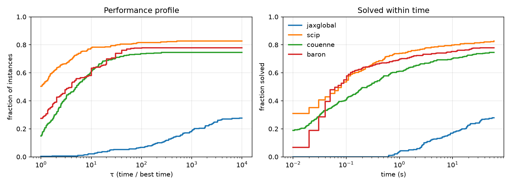

# Benchmark `baseline`

322 continuous MINLPLib instances with ≤ 50 variables, time limit 60 s, relative gap 1e-4. Results are checked against the MINLPLib reference bounds (see `benchmarks/report.py`).

| solver | solved | wrong | unsolved | unsupported | SGM time (s) |
|---|---|---|---|---|---|
| jaxglobal | 90 | 8 | 74 | 150 | 33.22 |
| scip | 266 | 4 | 52 | 0 | 1.59 |
| couenne | 241 | 7 | 74 | 0 | 2.91 |
| baron | 252 | 2 | 50 | 18 | 2.06 |

SGM: shifted geometric mean (shift 1 s) over all instances; unsolved, wrong and unsupported count as the time limit.

## Solved by size

| variables | instances | jaxglobal | scip | couenne | baron |
|---|---|---|---|---|---|
| 1–5 | 119 | 54 | 106 | 99 | 96 |
| 6–10 | 83 | 29 | 69 | 67 | 62 |
| 11–20 | 63 | 7 | 54 | 52 | 56 |
| 21–50 | 57 | 0 | 37 | 23 | 38 |

## Results that contradict the reference

| solver | instance | status | primal | dual | reference primal | reference dual |
|---|---|---|---|---|---|---|
| jaxglobal | ex6_2_6 | optimal | 7.1076254e-07 | -2.8225092e-07 | -2.6025271e-06 | -3.4978312e-06 |
| jaxglobal | kall_diffcircles_5a | optimal | 8.9142858 | 8.9142858 | 5.1161789 | 5.1161789 |
| jaxglobal | kall_diffcircles_5b | optimal | 6.222831 | 6.222831 | 5.1161789 | 5.1161782 |
| jaxglobal | kall_circles_c6a | optimal | 3.5937199 | 3.5937199 | 2.1117155 | 2.1117137 |
| jaxglobal | kall_circles_c6c | optimal | 3.5189942 | 3.5189942 | 2.7977041 | 1.7700241 |
| jaxglobal | kall_diffcircles_8 | optimal | 20.524613 | 20.524613 | 14.481259 | 14.481259 |
| jaxglobal | kall_diffcircles_9 | optimal | 19.393639 | 19.393639 | 13.350285 | 13.350283 |
| jaxglobal | kall_diffcircles_10 | time_limit | nan | 5406720 | 11.935495 | 11.935492 |
| scip | ex8_5_3 | optimal | -0.0041408313 | -0.0041417398 | -0.0041354299 | -0.0041357925 |
| scip | ex8_5_4 | optimal | -0.00042755106 | -0.00042755106 | -0.0004251471 | -0.00042603362 |
| scip | st_qpc-m3b | optimal | -1.0077745e-06 | -1.0077745e-06 | 0 | 0 |
| scip | ex7_3_5 | optimal | 1.2053956 | 1.2053956 | 1.2068714 | 1.206653 |
| couenne | ex8_1_2 | optimal | -1.15858 | -1.15858 | -1.070861 | -1.0708675 |
| couenne | ex14_1_9 | optimal | -0.66443 | -0.66443 | -8.0491169e-16 | -8.0491169e-16 |
| couenne | inscribedsquare03 | optimal | 17.8291 | 17.8291 | 23.849381 | 23.849528 |
| couenne | alkylation | optimal | 1742.49 | 1742.65 | 1768.807 | 1768.807 |
| couenne | process | optimal | -1133.4 | -1133.45 | -1161.3366 | -1161.3366 |
| couenne | st_e03 | optimal | -1071.34 | -1071.35 | -1161.3366 | -1161.3366 |
| couenne | wastewater04m1 | optimal | 90.9587 | 90.9587 | 89.836066 | 89.836066 |
| baron | ex6_2_14 | error | -1.2496774e+23 | -1.2496774e+23 | -0.69535793 | -0.6953583 |
| baron | ex7_3_5 | optimal | 0.7396664 | 0.7396664 | 1.2068714 | 1.206653 |

## Unsupported

- jaxglobal: unbounded variables (150)
- baron: Cannot handle function 'cos' (11)
- baron: Cannot handle function 'sin' (6)
- baron: Cannot handle function 'tanh' (1)

