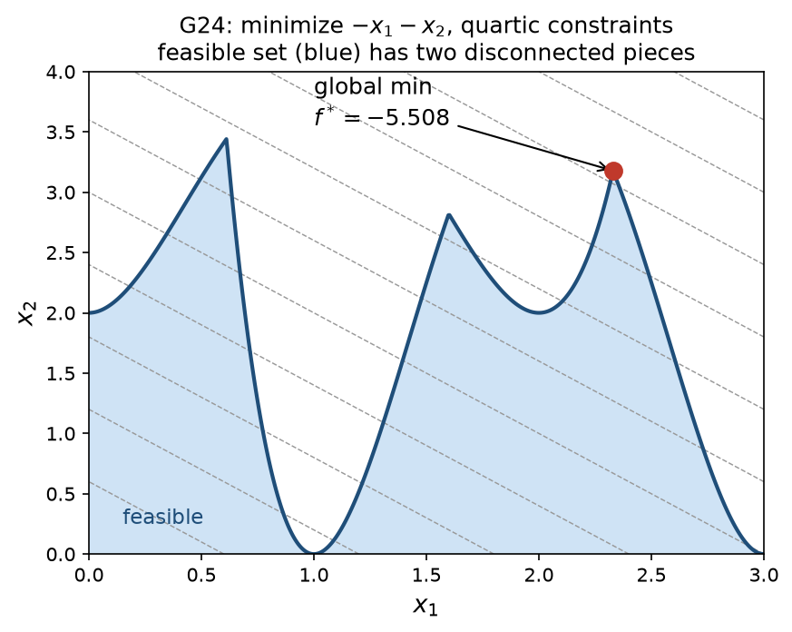

<!-- _paginate: false -->

# jaxglobal

## Certified global optimization of plain JAX functions — no equations

**John Kitchin** · Carnegie Mellon University
Prototype / proof of concept · October 2026

---

## The idea in one slide

<div class="cols"><div>

```python
import jax.numpy as jnp
from jaxglobal import minimize

def f(x):  # Eggholder: very rugged
    a, b = x[0], x[1]
    return (-(b + 47) * jnp.sin(jnp.sqrt(jnp.abs(a/2 + b + 47)))
            - a * jnp.sin(jnp.sqrt(jnp.abs(a - (b + 47)))))

r = minimize(f, [-512, -512], [512, 512])
# fun=-959.64066  lower_bound=-959.64144
# nodes=153  time=0.5 s
```

</div><div>

- Input: a **Python function** and a box
- Optional constraints: `ineq(x) <= 0`, `eq(x) == 0`
- Output: best point **and a proven lower bound**
- No algebraic model, no modeling language

</div></div>

<div class="take">Global optimality is certified: no point in the box can beat the lower bound.</div>

---

## Why: models increasingly live in code, not equations

- Equation-based global solvers need an **algebraic model**
  - BARON, SCIP, Couenne, ANTIGONE, LindoGlobal
- Real objectives are Python: simulators, surrogates, neural nets
- Rewriting them in GAMS or Pyomo is slow and error-prone
- Function support varies: BARON rejects `sin`; SCIP rejects `tanh`

<div class="take">Can a global solver work from the <b>code</b> instead of the equations?</div>

---

## How it works

<div class="pipe">
<div><b>1. Trace</b><code>jax.make_jaxpr(f)</code> gives a flat list of primitives</div>
<div class="arrow">→</div>
<div><b>2. Relax</b>re-run the jaxpr on McCormick objects <code>MC(lo, hi, cv, cc)</code></div>
<div class="arrow">→</div>
<div><b>3. Bound</b>convex cuts via <code>jax.grad</code> → LP + duality certificate</div>
<div class="arrow">→</div>
<div><b>4. Branch</b>batched spatial B&B; <code>jit(vmap)</code> over 256 boxes</div>
</div>

<br>

- The relaxation is **itself a JAX function**
- So it can be jitted, vectorized, and differentiated for free

---

## Step 1 — the jaxpr is the "equations"

<div class="cols"><div>

```python
def f(x):
    return jnp.sin(3*x[0])*x[1] + jnp.exp(x[1])
```

Loops, helper functions, `jnp.where`, `jax.nn.*` all flatten into primitives.

</div><div>

```text
{ lambda ; a:f32[2]. let
    b = slice[0:1] a
    c = squeeze b
    d = mul 3.0 c
    e = sin d
    f = slice[1:2] a
    g = squeeze f
    h = mul e g
    ...
    k = exp j
    l = add h k
  in (l,) }
```

</div></div>

---

## Step 2 — one relaxation rule per primitive

| primitive class | examples | rule |
|---|---|---|
| structural, positive-linear | slice, add, reduce_sum, gather | component-wise |
| signed linear | neg, sub, `dot` by constant | swap cv/cc by sign |
| bilinear | `mul` of two variables | McCormick product rule |
| known envelopes | exp, log, sqrt, xⁿ, \|x\|, 1/x | convex/concave composition |
| other smooth | sin, cos, tanh, erf, atan, logistic | **automatic αBB** |
| logic | comparisons, `select_n` | interval decides, else hull |

<p class="small">62 primitive rules; unsupported ones raise a clear error.</p>

---

## Automatic αBB: no hand-derived envelopes

For a smooth primitive $\phi$ on $[l, u]$:

$$
\phi^{cv}(z) = \phi(z) + \tfrac{\alpha}{2}(z-l)(z-u), \qquad \alpha = \max\!\left(0, -\min_{[l,u]} \phi''\right)
$$

- $\phi''$ comes from **tracing `jax.grad(jax.grad(φ))`**
- That jaxpr is evaluated in **interval mode** → bound on $\phi''$
- Adding a new primitive needs only its range function

---

## Relaxations tighten as boxes shrink


<p class="small">Gramacy–Lee, sin(10πx)/(2x) + (x−1)⁴: convex (cv) and concave (cc) relaxations on 1, 4 and 16 boxes.</p>

---

## Step 3 — valid bounds from cuts

<div class="cols"><div>

**Unconstrained**
- Frank–Wolfe on $f^{cv}$ with `jax.grad`
- Each iterate gives a cut:
  $f^{cv}(x) + g\cdot(v - x)$
- Max of cuts and interval bound

</div><div>

**Constrained**
- Cuts on $f^{cv}, g^{cv}, h^{cv}, -h^{cc}$
- Small LP solved by a JAX interior point
- Bound from **weak duality**, valid for any $y \ge 0$

</div></div>

<div class="take">The bound never trusts the LP solver: a bad solve gives a weaker bound, not a wrong one.</div>

---

## A lesson: tie gradients break certificates

- Eggholder first "proved" −935; the true optimum is **−959.64**
- `jnp.minimum` / `maximum` split the gradient **50/50 at ties**
- That blended concave slopes into convex subgradients
- Fix: choose branches with `jnp.where`
- Now a test checks every cut against sampled points

<div class="take">Autodiff conventions matter when gradients become proofs.</div>

---

## Example: 14 nonconvex test functions


<p class="small">All 14 reach the literature optimum with a proven gap ≤ 1e-6 rel., in 0.2–0.7 s and 23–8,883 nodes.</p>

---

## Example: constrained problems

<div class="cols"><div>



</div><div>

```python
def f(x):    return -x[0] - x[1]
def ineq(x): return jnp.stack([
    -2*x[0]**4 + 8*x[0]**3
      - 8*x[0]**2 + x[1] - 2,
    -4*x[0]**4 + 32*x[0]**3
      - 88*x[0]**2 + 96*x[0] + x[1] - 36])

minimize(f, [0, 0], [3, 4], ineq=ineq)
# fun=-5.508013 (proven), 43 nodes
```

</div></div>

---

## Constrained benchmark set

| problem | n | features | f* | nodes |
|---|---|---|---|---|
| G06 / G08 / G24 | 2 | cubic, sin³/poly, disconnected feasible set | ✓ | 43–99 |
| G11 | 2 | equality on a parabola | ✓ | 127 |
| G04 | 5 | bilinear, double-sided constraints | ✓ | 67 |
| Haverly pooling | 9 | bilinear equalities | −400 ✓ | 157 |
| Reactor network | 6 | √ + bilinear equalities | ✓ | 1935 |

<p class="small">Classic small test problems: hard for local and evolutionary methods, routine for spatial B&B.</p>

---

## Comparison: what each approach needs

| | jaxglobal | SCIP | Couenne | BARON | LindoGlobal |
|---|---|---|---|---|---|
| input | Python function | algebraic model | `.nl` model | algebraic model | GAMS model |
| sin / cos | ✓ auto αBB | ✓ | ✓ | ✗ | ✓ |
| tanh | ✓ auto αBB | ✗ | ✓ | ✗ | ✓ |
| `where` / `max` | ✓ | reformulate | reformulate | reformulate | reformulate |
| bound tightening, cut generation | ✗ (none yet) | ✓ | ✓ | ✓ | ✓ |

<p class="small">For the benchmark, Pyomo models are built from the <b>same</b> Python functions with a jnp→Pyomo shim; <code>where</code>/<code>max</code>/<code>tanh</code> needed hand reformulation.</p>

---

## Benchmark: wall time to a certified optimum

BENCHMARK_FIGURE

---

## Benchmark: results

BENCHMARK_TABLE

---

## Benchmark: takeaways

BENCHMARK_TAKEAWAYS

---

## Under the hood: what is JAX today?

| component | implementation | JAX |
|---|---|---|
| relaxations (McCormick, αBB, intervals) | jaxpr interpreter | ✓ |
| unconstrained lower bound | Frank–Wolfe cuts via `jax.grad` | ✓ |
| constrained lower bound | own interior-point LP + duality certificate | ✓ |
| upper bound (local solve) | scipy L-BFGS-B / SLSQP + JAX gradients | ✗ |
| B&B loop: queue, pruning, bisection | numpy on host | ✗ |

<div class="take">No external global solver: bounding is one <code>jit(vmap)</code> kernel over 256 boxes; local solves and bookkeeping still run on the CPU host.</div>

---

## Benefits of an all-JAX global solver

<div class="cols"><div>

- **One source of truth**: optimize the code you simulate and train
- **No translation step**: no shim, no hand reformulation
- **Batching**: thousands of boxes per kernel call

</div><div>

- **Hardware**: same kernel on CPU, GPU, TPU
- **Autodiff everywhere**: cuts, Jacobians, f″ bounds
- **Open**: `pip install jax`; no licenses

</div></div>

---

## Measured: batching and where the time goes

THROUGHPUT_FIGURE

---

## Costs, and the path to a fully-JAX solver

<div class="cols"><div>

**Costs today**
- JIT compile: often most of a small solve
- Fixed shapes: padding, fixed iteration counts
- Host ↔ device sync every B&B iteration

</div><div>

**Path forward**
- Batched JAX local solver, `vmap` over starts
- Node queue on device in `lax.while_loop`
- Then the whole solve is `jit`/`vmap`-able
- Parameter sweeps run as one batched call

</div></div>

---

## Limitations and next steps

- Plain McCormick + αBB; **no bound tightening (FBBT/OBBT) yet**
- Dense LP per node, fixed iteration count
- Upper bounds from scipy SLSQP: the main constrained-time cost
- Small problems only (≤ 9 variables so far)
- Next: FBBT on the jaxpr, GPU batches, harder pooling sets (Adhya, Ben-Tal)

---

## Summary

- A global solver that reads **code**, not equations
- The jaxpr is a free, exact expression graph
- Relaxations are JAX functions: **jit, vmap, grad** come free
- Certified optima on 21 nonconvex problems, with and without constraints
- Covers functions that equation-based solvers reject or need rewritten

<div class="take">Code: <code>jaxglobal/</code> · relax.py (rules) · bnb.py (B&B) · lp.py (constrained bounds)</div>
